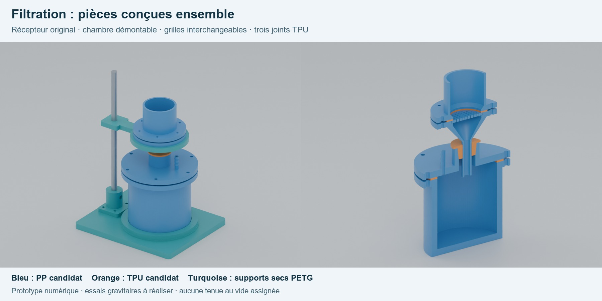

# Pièces imprimables

*[English](README.md) · Français*

Pièces imprimables et sources CAO modifiables pour l'atelier et le laboratoire.

| Pièce | Description |
|---|---|
| [bride-ventirad](bride-ventirad/) | Bride en compression pour un vieux ventirad sur ASRock FM2A88M Extreme4+ (FM2+) |
| [chimie-lab](chimie-lab/) | 80 pièces originales : portoirs, récipients, outils d'immersion et de filtration, avec STL, STEP, FreeCAD et sources Python paramétriques |

Chaque pièce possède son dossier, ses fichiers d'impression, ses sources CAO et sa notice. Les conceptions OpenSCAD conservent leurs `.scad` ; la bibliothèque de chimie utilise des sources Python/JSON avec FreeCAD.

[Parcourir le catalogue de chimie](chimie-lab/CATALOGUE.md). Ces modèles sont des prototypes numériques ; la compatibilité chimique, l'étanchéité, la chauffe et la tenue au vide ne sont pas physiquement qualifiées.

## Choix des matières

Choisir le filament selon la fonction de la pièce. Les indications fournies avec chaque modèle priment sur cette vue d'ensemble.

| Matière candidate | Fonction habituelle |
|---|---|
| **PP** | Récipients et pièces de filtration destinés à des liquides compatibles |
| **PETG** | Supports, portoirs et rangements à sec |
| **TPU** | Joints souples, selon leur compatibilité avec le produit |

Pour le contact chimique, vérifier le grade exact du filament, le réactif, sa concentration, la température et la durée de contact. Ces indications ne prouvent pas la résistance chimique, l'étanchéité ou l'aptitude à la chauffe ou au vide.
