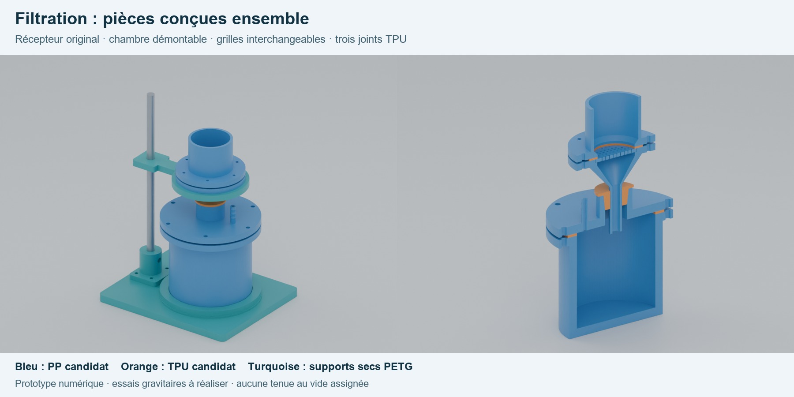

# Printable parts

*English · [Français](README.fr.md)*

Printable parts and editable CAD sources for workshop and laboratory use.

| Part | Description |
|---|---|
| [bride-ventirad](bride-ventirad/) | Compression bracket for an old CPU cooler on an ASRock FM2A88M Extreme4+ (FM2+) |
| [chimie-lab](chimie-lab/) | 80 original parts: racks, vessels, immersion and filtration tools, with STL, STEP, FreeCAD and parametric Python sources |

Each part has its own folder with printing files, CAD sources and notes. OpenSCAD designs include their `.scad` files; the chemistry collection uses Python/JSON sources with FreeCAD.

[Browse the chemistry catalogue](chimie-lab/CATALOGUE.md). These are digital prototypes; chemical compatibility, leak tightness, heating and vacuum use have not been physically qualified.

## Material selection

Choose the filament according to the part's role. The material notes supplied with each model take precedence over this overview.

| Material candidate | Typical role |
|---|---|
| **PP** | Vessels and filtration parts intended for compatible liquids |
| **PETG** | Dry stands, racks and organizers |
| **TPU** | Flexible seals, subject to compatibility with the medium |

For chemical contact, check the exact filament grade, reagent, concentration, temperature and exposure time. These suggestions do not establish chemical resistance, leak tightness or suitability for heating or vacuum use.
