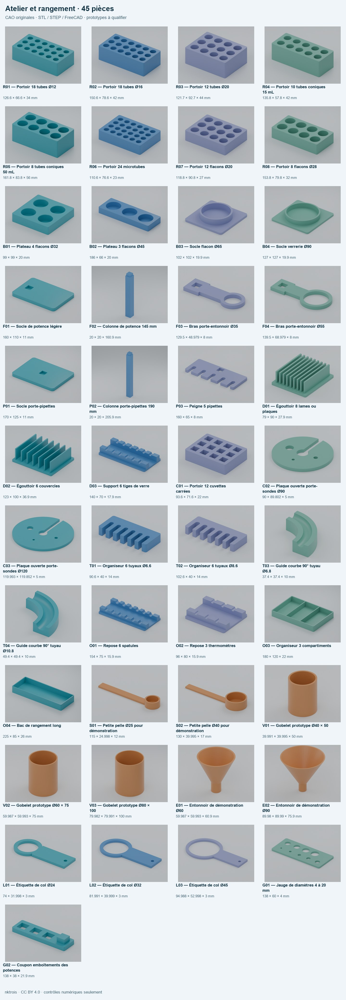
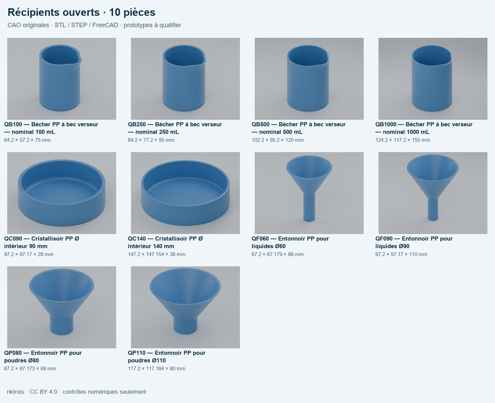
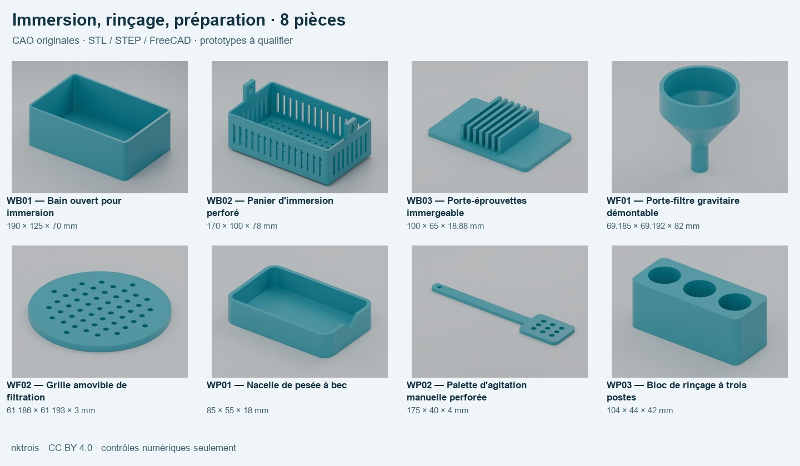
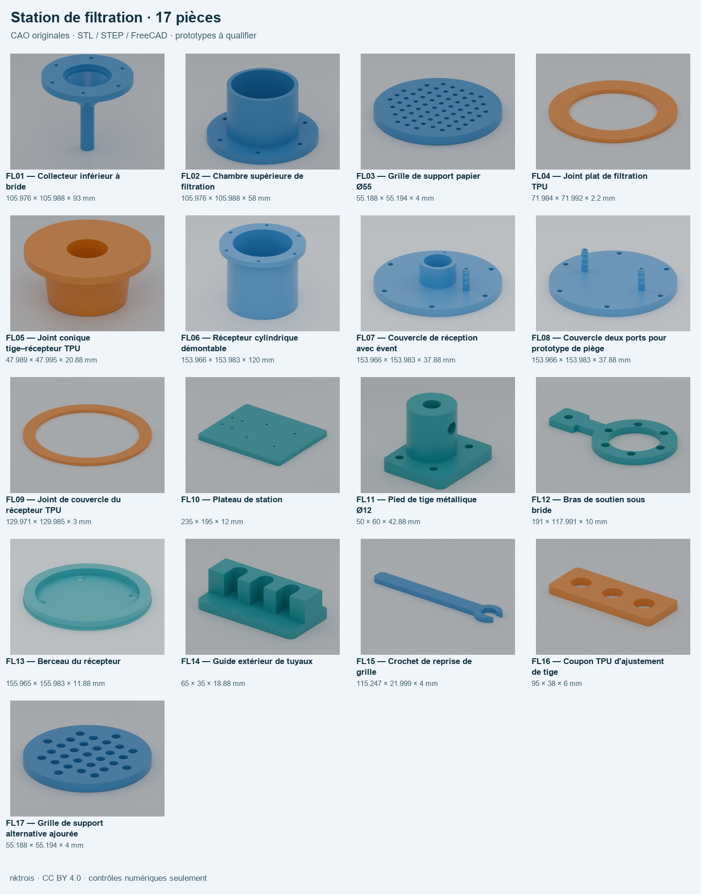

# Catalogue des 80 pièces originales

STL en mm · STEP · FreeCAD · CC BY 4.0. Les matières sont des candidates à qualifier. [Montage de filtration](filtration/README.md) · [Plan d'impression](IMPRESSION.md)

## Atelier et rangement · 45 pièces

| ID | Modèle | Encombrement mm | Matière candidate | Fichiers |
|---|---|---|---|---|
| [R01](originaux/01-portoirs/R01/README.md) | Portoir 18 tubes Ø12 | 126.6 × 66.6 × 34 | PETG | [stl](originaux/01-portoirs/R01/R01.stl) · [step](originaux/01-portoirs/R01/R01.step) · [FCStd](originaux/01-portoirs/R01/R01.FCStd) |
| [R02](originaux/01-portoirs/R02/README.md) | Portoir 18 tubes Ø16 | 150.6 × 78.6 × 42 | PETG | [stl](originaux/01-portoirs/R02/R02.stl) · [step](originaux/01-portoirs/R02/R02.step) · [FCStd](originaux/01-portoirs/R02/R02.FCStd) |
| [R03](originaux/01-portoirs/R03/README.md) | Portoir 12 tubes Ø20 | 121.7 × 92.7 × 44 | PETG | [stl](originaux/01-portoirs/R03/R03.stl) · [step](originaux/01-portoirs/R03/R03.step) · [FCStd](originaux/01-portoirs/R03/R03.FCStd) |
| [R04](originaux/01-portoirs/R04/README.md) | Portoir 10 tubes coniques 15 mL | 135.8 × 57.8 × 42 | PETG | [stl](originaux/01-portoirs/R04/R04.stl) · [step](originaux/01-portoirs/R04/R04.step) · [FCStd](originaux/01-portoirs/R04/R04.FCStd) |
| [R05](originaux/01-portoirs/R05/README.md) | Portoir 8 tubes coniques 50 mL | 161.8 × 83.8 × 56 | PETG | [stl](originaux/01-portoirs/R05/R05.stl) · [step](originaux/01-portoirs/R05/R05.step) · [FCStd](originaux/01-portoirs/R05/R05.FCStd) |
| [R06](originaux/01-portoirs/R06/README.md) | Portoir 24 microtubes | 110.6 × 76.6 × 23 | PETG | [stl](originaux/01-portoirs/R06/R06.stl) · [step](originaux/01-portoirs/R06/R06.step) · [FCStd](originaux/01-portoirs/R06/R06.FCStd) |
| [R07](originaux/01-portoirs/R07/README.md) | Portoir 12 flacons Ø20 | 118.8 × 90.8 × 27 | PETG | [stl](originaux/01-portoirs/R07/R07.stl) · [step](originaux/01-portoirs/R07/R07.step) · [FCStd](originaux/01-portoirs/R07/R07.FCStd) |
| [R08](originaux/01-portoirs/R08/README.md) | Portoir 8 flacons Ø28 | 153.8 × 79.8 × 32 | PETG | [stl](originaux/01-portoirs/R08/R08.stl) · [step](originaux/01-portoirs/R08/R08.step) · [FCStd](originaux/01-portoirs/R08/R08.FCStd) |
| [B01](originaux/02-flacons/B01/README.md) | Plateau 4 flacons Ø32 | 99 × 99 × 20 | PETG | [stl](originaux/02-flacons/B01/B01.stl) · [step](originaux/02-flacons/B01/B01.step) · [FCStd](originaux/02-flacons/B01/B01.FCStd) |
| [B02](originaux/02-flacons/B02/README.md) | Plateau 3 flacons Ø45 | 186 × 66 × 20 | PETG | [stl](originaux/02-flacons/B02/B02.stl) · [step](originaux/02-flacons/B02/B02.step) · [FCStd](originaux/02-flacons/B02/B02.FCStd) |
| [B03](originaux/02-flacons/B03/README.md) | Socle flacon Ø65 | 102 × 102 × 19.9 | PETG | [stl](originaux/02-flacons/B03/B03.stl) · [step](originaux/02-flacons/B03/B03.step) · [FCStd](originaux/02-flacons/B03/B03.FCStd) |
| [B04](originaux/02-flacons/B04/README.md) | Socle verrerie Ø90 | 127 × 127 × 19.9 | PETG | [stl](originaux/02-flacons/B04/B04.stl) · [step](originaux/02-flacons/B04/B04.step) · [FCStd](originaux/02-flacons/B04/B04.FCStd) |
| [F01](originaux/03-potences/F01/README.md) | Socle de potence légère | 160 × 110 × 11 | PETG | [stl](originaux/03-potences/F01/F01.stl) · [step](originaux/03-potences/F01/F01.step) · [FCStd](originaux/03-potences/F01/F01.FCStd) |
| [F02](originaux/03-potences/F02/README.md) | Colonne de potence 145 mm | 20 × 20 × 160.9 | PETG | [stl](originaux/03-potences/F02/F02.stl) · [step](originaux/03-potences/F02/F02.step) · [FCStd](originaux/03-potences/F02/F02.FCStd) |
| [F03](originaux/03-potences/F03/README.md) | Bras porte-entonnoir Ø35 | 129.5 × 48.979 × 8 | PETG | [stl](originaux/03-potences/F03/F03.stl) · [step](originaux/03-potences/F03/F03.step) · [FCStd](originaux/03-potences/F03/F03.FCStd) |
| [F04](originaux/03-potences/F04/README.md) | Bras porte-entonnoir Ø55 | 139.5 × 68.979 × 8 | PETG | [stl](originaux/03-potences/F04/F04.stl) · [step](originaux/03-potences/F04/F04.step) · [FCStd](originaux/03-potences/F04/F04.FCStd) |
| [P01](originaux/04-pipettes/P01/README.md) | Socle porte-pipettes | 170 × 125 × 11 | PETG | [stl](originaux/04-pipettes/P01/P01.stl) · [step](originaux/04-pipettes/P01/P01.step) · [FCStd](originaux/04-pipettes/P01/P01.FCStd) |
| [P02](originaux/04-pipettes/P02/README.md) | Colonne porte-pipettes 190 mm | 20 × 20 × 205.9 | PETG | [stl](originaux/04-pipettes/P02/P02.stl) · [step](originaux/04-pipettes/P02/P02.step) · [FCStd](originaux/04-pipettes/P02/P02.FCStd) |
| [P03](originaux/04-pipettes/P03/README.md) | Peigne 5 pipettes | 160 × 65 × 8 | PETG | [stl](originaux/04-pipettes/P03/P03.stl) · [step](originaux/04-pipettes/P03/P03.step) · [FCStd](originaux/04-pipettes/P03/P03.FCStd) |
| [D01](originaux/05-sechage/D01/README.md) | Égouttoir 8 lames ou plaques | 79 × 90 × 27.9 | PETG | [stl](originaux/05-sechage/D01/D01.stl) · [step](originaux/05-sechage/D01/D01.step) · [FCStd](originaux/05-sechage/D01/D01.FCStd) |
| [D02](originaux/05-sechage/D02/README.md) | Égouttoir 6 couvercles | 123 × 100 × 36.9 | PETG | [stl](originaux/05-sechage/D02/D02.stl) · [step](originaux/05-sechage/D02/D02.step) · [FCStd](originaux/05-sechage/D02/D02.FCStd) |
| [D03](originaux/05-sechage/D03/README.md) | Support 6 tiges de verre | 140 × 70 × 17.9 | PETG | [stl](originaux/05-sechage/D03/D03.stl) · [step](originaux/05-sechage/D03/D03.step) · [FCStd](originaux/05-sechage/D03/D03.FCStd) |
| [C01](originaux/06-mesure/C01/README.md) | Portoir 12 cuvettes carrées | 93.6 × 71.6 × 22 | PETG | [stl](originaux/06-mesure/C01/C01.stl) · [step](originaux/06-mesure/C01/C01.step) · [FCStd](originaux/06-mesure/C01/C01.FCStd) |
| [C02](originaux/06-mesure/C02/README.md) | Plaque ouverte porte-sondes Ø90 | 90 × 89.802 × 5 | PETG | [stl](originaux/06-mesure/C02/C02.stl) · [step](originaux/06-mesure/C02/C02.step) · [FCStd](originaux/06-mesure/C02/C02.FCStd) |
| [C03](originaux/06-mesure/C03/README.md) | Plaque ouverte porte-sondes Ø120 | 119.993 × 119.852 × 5 | PETG | [stl](originaux/06-mesure/C03/C03.stl) · [step](originaux/06-mesure/C03/C03.step) · [FCStd](originaux/06-mesure/C03/C03.FCStd) |
| [T01](originaux/07-tuyaux/T01/README.md) | Organiseur 6 tuyaux Ø6.6 | 90.6 × 40 × 14 | PETG | [stl](originaux/07-tuyaux/T01/T01.stl) · [step](originaux/07-tuyaux/T01/T01.step) · [FCStd](originaux/07-tuyaux/T01/T01.FCStd) |
| [T02](originaux/07-tuyaux/T02/README.md) | Organiseur 6 tuyaux Ø8.6 | 102.6 × 40 × 14 | PETG | [stl](originaux/07-tuyaux/T02/T02.stl) · [step](originaux/07-tuyaux/T02/T02.step) · [FCStd](originaux/07-tuyaux/T02/T02.FCStd) |
| [T03](originaux/07-tuyaux/T03/README.md) | Guide courbe 90° tuyau Ø6.8 | 37.4 × 37.4 × 10 | PETG | [stl](originaux/07-tuyaux/T03/T03.stl) · [step](originaux/07-tuyaux/T03/T03.step) · [FCStd](originaux/07-tuyaux/T03/T03.FCStd) |
| [T04](originaux/07-tuyaux/T04/README.md) | Guide courbe 90° tuyau Ø10.8 | 49.4 × 49.4 × 10 | PETG | [stl](originaux/07-tuyaux/T04/T04.stl) · [step](originaux/07-tuyaux/T04/T04.step) · [FCStd](originaux/07-tuyaux/T04/T04.FCStd) |
| [O01](originaux/08-rangement/O01/README.md) | Repose 6 spatules | 154 × 75 × 15.9 | PETG | [stl](originaux/08-rangement/O01/O01.stl) · [step](originaux/08-rangement/O01/O01.step) · [FCStd](originaux/08-rangement/O01/O01.FCStd) |
| [O02](originaux/08-rangement/O02/README.md) | Repose 3 thermomètres | 96 × 80 × 15.9 | PETG | [stl](originaux/08-rangement/O02/O02.stl) · [step](originaux/08-rangement/O02/O02.step) · [FCStd](originaux/08-rangement/O02/O02.FCStd) |
| [O03](originaux/08-rangement/O03/README.md) | Organiseur 3 compartiments | 180 × 120 × 22 | PETG | [stl](originaux/08-rangement/O03/O03.stl) · [step](originaux/08-rangement/O03/O03.step) · [FCStd](originaux/08-rangement/O03/O03.FCStd) |
| [O04](originaux/08-rangement/O04/README.md) | Bac de rangement long | 225 × 85 × 26 | PETG | [stl](originaux/08-rangement/O04/O04.stl) · [step](originaux/08-rangement/O04/O04.step) · [FCStd](originaux/08-rangement/O04/O04.FCStd) |
| [S01](originaux/09-contact-conditionnel/S01/README.md) | Petite pelle Ø25 pour démonstration | 115 × 24.998 × 12 | PP compatible avec le produit, à qualifier | [stl](originaux/09-contact-conditionnel/S01/S01.stl) · [step](originaux/09-contact-conditionnel/S01/S01.step) · [FCStd](originaux/09-contact-conditionnel/S01/S01.FCStd) |
| [S02](originaux/09-contact-conditionnel/S02/README.md) | Petite pelle Ø40 pour démonstration | 130 × 39.995 × 17 | PP compatible avec le produit, à qualifier | [stl](originaux/09-contact-conditionnel/S02/S02.stl) · [step](originaux/09-contact-conditionnel/S02/S02.step) · [FCStd](originaux/09-contact-conditionnel/S02/S02.FCStd) |
| [V01](originaux/09-contact-conditionnel/V01/README.md) | Gobelet prototype Ø40 × 50 | 39.991 × 39.995 × 50 | PP compatible avec le liquide, à qualifier | [stl](originaux/09-contact-conditionnel/V01/V01.stl) · [step](originaux/09-contact-conditionnel/V01/V01.step) · [FCStd](originaux/09-contact-conditionnel/V01/V01.FCStd) |
| [V02](originaux/09-contact-conditionnel/V02/README.md) | Gobelet prototype Ø60 × 75 | 59.987 × 59.993 × 75 | PP compatible avec le liquide, à qualifier | [stl](originaux/09-contact-conditionnel/V02/V02.stl) · [step](originaux/09-contact-conditionnel/V02/V02.step) · [FCStd](originaux/09-contact-conditionnel/V02/V02.FCStd) |
| [V03](originaux/09-contact-conditionnel/V03/README.md) | Gobelet prototype Ø80 × 100 | 79.982 × 79.991 × 100 | PP compatible avec le liquide, à qualifier | [stl](originaux/09-contact-conditionnel/V03/V03.stl) · [step](originaux/09-contact-conditionnel/V03/V03.step) · [FCStd](originaux/09-contact-conditionnel/V03/V03.FCStd) |
| [E01](originaux/09-contact-conditionnel/E01/README.md) | Entonnoir de démonstration Ø60 | 59.987 × 59.993 × 60.9 | PP compatible avec le liquide, à qualifier | [stl](originaux/09-contact-conditionnel/E01/E01.stl) · [step](originaux/09-contact-conditionnel/E01/E01.step) · [FCStd](originaux/09-contact-conditionnel/E01/E01.FCStd) |
| [E02](originaux/09-contact-conditionnel/E02/README.md) | Entonnoir de démonstration Ø90 | 89.98 × 89.99 × 75.9 | PP compatible avec le liquide, à qualifier | [stl](originaux/09-contact-conditionnel/E02/E02.stl) · [step](originaux/09-contact-conditionnel/E02/E02.step) · [FCStd](originaux/09-contact-conditionnel/E02/E02.FCStd) |
| [L01](originaux/10-etiquetage/L01/README.md) | Étiquette de col Ø24 | 74 × 31.998 × 3 | PETG | [stl](originaux/10-etiquetage/L01/L01.stl) · [step](originaux/10-etiquetage/L01/L01.step) · [FCStd](originaux/10-etiquetage/L01/L01.FCStd) |
| [L02](originaux/10-etiquetage/L02/README.md) | Étiquette de col Ø32 | 81.991 × 39.999 × 3 | PETG | [stl](originaux/10-etiquetage/L02/L02.stl) · [step](originaux/10-etiquetage/L02/L02.step) · [FCStd](originaux/10-etiquetage/L02/L02.FCStd) |
| [L03](originaux/10-etiquetage/L03/README.md) | Étiquette de col Ø45 | 94.988 × 52.998 × 3 | PETG | [stl](originaux/10-etiquetage/L03/L03.stl) · [step](originaux/10-etiquetage/L03/L03.step) · [FCStd](originaux/10-etiquetage/L03/L03.FCStd) |
| [G01](originaux/11-calibration/G01/README.md) | Jauge de diamètres 4 à 20 mm | 138 × 60 × 4 | PETG | [stl](originaux/11-calibration/G01/G01.stl) · [step](originaux/11-calibration/G01/G01.step) · [FCStd](originaux/11-calibration/G01/G01.FCStd) |
| [G02](originaux/11-calibration/G02/README.md) | Coupon emboîtements des potences | 138 × 38 × 21.9 | PETG | [stl](originaux/11-calibration/G02/G02.stl) · [step](originaux/11-calibration/G02/G02.step) · [FCStd](originaux/11-calibration/G02/G02.FCStd) |

## Récipients ouverts · 10 pièces

| ID | Modèle | Encombrement mm | Matière candidate | Fichiers |
|---|---|---|---|---|
| [QB100](recipients-chimiques/modeles/QB100/README.md) | Bécher PP à bec verseur — nominal 100 mL | 64.2 × 57.2 × 75 | PP non chargé, grade et usage à qualifier | [stl](recipients-chimiques/modeles/QB100/QB100.stl) · [step](recipients-chimiques/modeles/QB100/QB100.step) · [FCStd](recipients-chimiques/modeles/QB100/QB100.FCStd) |
| [QB250](recipients-chimiques/modeles/QB250/README.md) | Bécher PP à bec verseur — nominal 250 mL | 84.2 × 77.2 × 95 | PP non chargé, grade et usage à qualifier | [stl](recipients-chimiques/modeles/QB250/QB250.stl) · [step](recipients-chimiques/modeles/QB250/QB250.step) · [FCStd](recipients-chimiques/modeles/QB250/QB250.FCStd) |
| [QB500](recipients-chimiques/modeles/QB500/README.md) | Bécher PP à bec verseur — nominal 500 mL | 102.2 × 95.2 × 120 | PP non chargé, grade et usage à qualifier | [stl](recipients-chimiques/modeles/QB500/QB500.stl) · [step](recipients-chimiques/modeles/QB500/QB500.step) · [FCStd](recipients-chimiques/modeles/QB500/QB500.FCStd) |
| [QB1000](recipients-chimiques/modeles/QB1000/README.md) | Bécher PP à bec verseur — nominal 1000 mL | 124.2 × 117.2 × 155 | PP non chargé, grade et usage à qualifier | [stl](recipients-chimiques/modeles/QB1000/QB1000.stl) · [step](recipients-chimiques/modeles/QB1000/QB1000.step) · [FCStd](recipients-chimiques/modeles/QB1000/QB1000.FCStd) |
| [QC090](recipients-chimiques/modeles/QC090/README.md) | Cristallisoir PP Ø intérieur 90 mm | 97.2 × 97.17 × 28 | PP non chargé, grade et usage à qualifier | [stl](recipients-chimiques/modeles/QC090/QC090.stl) · [step](recipients-chimiques/modeles/QC090/QC090.step) · [FCStd](recipients-chimiques/modeles/QC090/QC090.FCStd) |
| [QC140](recipients-chimiques/modeles/QC140/README.md) | Cristallisoir PP Ø intérieur 140 mm | 147.2 × 147.154 × 38 | PP non chargé, grade et usage à qualifier | [stl](recipients-chimiques/modeles/QC140/QC140.stl) · [step](recipients-chimiques/modeles/QC140/QC140.step) · [FCStd](recipients-chimiques/modeles/QC140/QC140.FCStd) |
| [QF060](recipients-chimiques/modeles/QF060/README.md) | Entonnoir PP pour liquides Ø60 | 67.2 × 67.179 × 88 | PP non chargé, grade et usage à qualifier | [stl](recipients-chimiques/modeles/QF060/QF060.stl) · [step](recipients-chimiques/modeles/QF060/QF060.step) · [FCStd](recipients-chimiques/modeles/QF060/QF060.FCStd) |
| [QF090](recipients-chimiques/modeles/QF090/README.md) | Entonnoir PP pour liquides Ø90 | 97.2 × 97.17 × 110 | PP non chargé, grade et usage à qualifier | [stl](recipients-chimiques/modeles/QF090/QF090.stl) · [step](recipients-chimiques/modeles/QF090/QF090.step) · [FCStd](recipients-chimiques/modeles/QF090/QF090.FCStd) |
| [QP080](recipients-chimiques/modeles/QP080/README.md) | Entonnoir PP pour poudres Ø80 | 87.2 × 87.173 × 68 | PP non chargé, grade et usage à qualifier | [stl](recipients-chimiques/modeles/QP080/QP080.stl) · [step](recipients-chimiques/modeles/QP080/QP080.step) · [FCStd](recipients-chimiques/modeles/QP080/QP080.FCStd) |
| [QP110](recipients-chimiques/modeles/QP110/README.md) | Entonnoir PP pour poudres Ø110 | 117.2 × 117.164 × 80 | PP non chargé, grade et usage à qualifier | [stl](recipients-chimiques/modeles/QP110/QP110.stl) · [step](recipients-chimiques/modeles/QP110/QP110.step) · [FCStd](recipients-chimiques/modeles/QP110/QP110.FCStd) |

## Immersion, rinçage, préparation · 8 pièces

| ID | Modèle | Encombrement mm | Matière candidate | Fichiers |
|---|---|---|---|---|
| [WB01](outils-humides/modeles/WB01/README.md) | Bain ouvert pour immersion | 190 × 125 × 70 | PP non chargé, référence et conditions à qualifier | [stl](outils-humides/modeles/WB01/WB01.stl) · [step](outils-humides/modeles/WB01/WB01.step) · [FCStd](outils-humides/modeles/WB01/WB01.FCStd) |
| [WB02](outils-humides/modeles/WB02/README.md) | Panier d'immersion perforé | 170 × 100 × 78 | PP non chargé, référence et conditions à qualifier | [stl](outils-humides/modeles/WB02/WB02.stl) · [step](outils-humides/modeles/WB02/WB02.step) · [FCStd](outils-humides/modeles/WB02/WB02.FCStd) |
| [WB03](outils-humides/modeles/WB03/README.md) | Porte-éprouvettes immergeable | 100 × 65 × 18.88 | PP non chargé, référence et conditions à qualifier | [stl](outils-humides/modeles/WB03/WB03.stl) · [step](outils-humides/modeles/WB03/WB03.step) · [FCStd](outils-humides/modeles/WB03/WB03.FCStd) |
| [WF01](outils-humides/modeles/WF01/README.md) | Porte-filtre gravitaire démontable | 69.185 × 69.192 × 82 | PP non chargé, référence et conditions à qualifier | [stl](outils-humides/modeles/WF01/WF01.stl) · [step](outils-humides/modeles/WF01/WF01.step) · [FCStd](outils-humides/modeles/WF01/WF01.FCStd) |
| [WF02](outils-humides/modeles/WF02/README.md) | Grille amovible de filtration | 61.186 × 61.193 × 3 | PP non chargé, référence et conditions à qualifier | [stl](outils-humides/modeles/WF02/WF02.stl) · [step](outils-humides/modeles/WF02/WF02.step) · [FCStd](outils-humides/modeles/WF02/WF02.FCStd) |
| [WP01](outils-humides/modeles/WP01/README.md) | Nacelle de pesée à bec | 85 × 55 × 18 | PP non chargé, référence et conditions à qualifier | [stl](outils-humides/modeles/WP01/WP01.stl) · [step](outils-humides/modeles/WP01/WP01.step) · [FCStd](outils-humides/modeles/WP01/WP01.FCStd) |
| [WP02](outils-humides/modeles/WP02/README.md) | Palette d'agitation manuelle perforée | 175 × 40 × 4 | PP non chargé, référence et conditions à qualifier | [stl](outils-humides/modeles/WP02/WP02.stl) · [step](outils-humides/modeles/WP02/WP02.step) · [FCStd](outils-humides/modeles/WP02/WP02.FCStd) |
| [WP03](outils-humides/modeles/WP03/README.md) | Bloc de rinçage à trois postes | 104 × 44 × 42 | PP non chargé, référence et conditions à qualifier | [stl](outils-humides/modeles/WP03/WP03.stl) · [step](outils-humides/modeles/WP03/WP03.step) · [FCStd](outils-humides/modeles/WP03/WP03.FCStd) |

## Station de filtration · 17 pièces

| ID | Modèle | Encombrement mm | Matière candidate | Fichiers |
|---|---|---|---|---|
| [FL01](filtration/modeles/FL01/README.md) | Collecteur inférieur à bride | 105.976 × 105.988 × 93 | PP | [stl](filtration/modeles/FL01/FL01.stl) · [step](filtration/modeles/FL01/FL01.step) · [FCStd](filtration/modeles/FL01/FL01.FCStd) |
| [FL02](filtration/modeles/FL02/README.md) | Chambre supérieure de filtration | 105.976 × 105.988 × 58 | PP | [stl](filtration/modeles/FL02/FL02.stl) · [step](filtration/modeles/FL02/FL02.step) · [FCStd](filtration/modeles/FL02/FL02.FCStd) |
| [FL03](filtration/modeles/FL03/README.md) | Grille de support papier Ø55 | 55.188 × 55.194 × 4 | PP | [stl](filtration/modeles/FL03/FL03.stl) · [step](filtration/modeles/FL03/FL03.step) · [FCStd](filtration/modeles/FL03/FL03.FCStd) |
| [FL04](filtration/modeles/FL04/README.md) | Joint plat de filtration TPU | 71.984 × 71.992 × 2.2 | TPU | [stl](filtration/modeles/FL04/FL04.stl) · [step](filtration/modeles/FL04/FL04.step) · [FCStd](filtration/modeles/FL04/FL04.FCStd) |
| [FL05](filtration/modeles/FL05/README.md) | Joint conique tige–récepteur TPU | 47.989 × 47.995 × 20.88 | TPU | [stl](filtration/modeles/FL05/FL05.stl) · [step](filtration/modeles/FL05/FL05.step) · [FCStd](filtration/modeles/FL05/FL05.FCStd) |
| [FL06](filtration/modeles/FL06/README.md) | Récepteur cylindrique démontable | 153.966 × 153.983 × 120 | PP | [stl](filtration/modeles/FL06/FL06.stl) · [step](filtration/modeles/FL06/FL06.step) · [FCStd](filtration/modeles/FL06/FL06.FCStd) |
| [FL07](filtration/modeles/FL07/README.md) | Couvercle de réception avec évent | 153.966 × 153.983 × 37.88 | PP | [stl](filtration/modeles/FL07/FL07.stl) · [step](filtration/modeles/FL07/FL07.step) · [FCStd](filtration/modeles/FL07/FL07.FCStd) |
| [FL08](filtration/modeles/FL08/README.md) | Couvercle deux ports pour prototype de piège | 153.966 × 153.983 × 37.88 | PP | [stl](filtration/modeles/FL08/FL08.stl) · [step](filtration/modeles/FL08/FL08.step) · [FCStd](filtration/modeles/FL08/FL08.FCStd) |
| [FL09](filtration/modeles/FL09/README.md) | Joint de couvercle du récepteur TPU | 129.971 × 129.985 × 3 | TPU | [stl](filtration/modeles/FL09/FL09.stl) · [step](filtration/modeles/FL09/FL09.step) · [FCStd](filtration/modeles/FL09/FL09.FCStd) |
| [FL10](filtration/modeles/FL10/README.md) | Plateau de station | 235 × 195 × 12 | PETG | [stl](filtration/modeles/FL10/FL10.stl) · [step](filtration/modeles/FL10/FL10.step) · [FCStd](filtration/modeles/FL10/FL10.FCStd) |
| [FL11](filtration/modeles/FL11/README.md) | Pied de tige métallique Ø12 | 50 × 60 × 42.88 | PETG | [stl](filtration/modeles/FL11/FL11.stl) · [step](filtration/modeles/FL11/FL11.step) · [FCStd](filtration/modeles/FL11/FL11.FCStd) |
| [FL12](filtration/modeles/FL12/README.md) | Bras de soutien sous bride | 191 × 117.991 × 10 | PETG | [stl](filtration/modeles/FL12/FL12.stl) · [step](filtration/modeles/FL12/FL12.step) · [FCStd](filtration/modeles/FL12/FL12.FCStd) |
| [FL13](filtration/modeles/FL13/README.md) | Berceau du récepteur | 155.965 × 155.983 × 11.88 | PETG | [stl](filtration/modeles/FL13/FL13.stl) · [step](filtration/modeles/FL13/FL13.step) · [FCStd](filtration/modeles/FL13/FL13.FCStd) |
| [FL14](filtration/modeles/FL14/README.md) | Guide extérieur de tuyaux | 65 × 35 × 18.88 | PETG | [stl](filtration/modeles/FL14/FL14.stl) · [step](filtration/modeles/FL14/FL14.step) · [FCStd](filtration/modeles/FL14/FL14.FCStd) |
| [FL15](filtration/modeles/FL15/README.md) | Crochet de reprise de grille | 115.247 × 21.999 × 4 | PP | [stl](filtration/modeles/FL15/FL15.stl) · [step](filtration/modeles/FL15/FL15.step) · [FCStd](filtration/modeles/FL15/FL15.FCStd) |
| [FL16](filtration/modeles/FL16/README.md) | Coupon TPU d'ajustement de tige | 95 × 38 × 6 | TPU | [stl](filtration/modeles/FL16/FL16.stl) · [step](filtration/modeles/FL16/FL16.step) · [FCStd](filtration/modeles/FL16/FL16.FCStd) |
| [FL17](filtration/modeles/FL17/README.md) | Grille de support alternative ajourée | 55.188 × 55.194 × 4 | PP | [stl](filtration/modeles/FL17/FL17.stl) · [step](filtration/modeles/FL17/FL17.step) · [FCStd](filtration/modeles/FL17/FL17.FCStd) |
