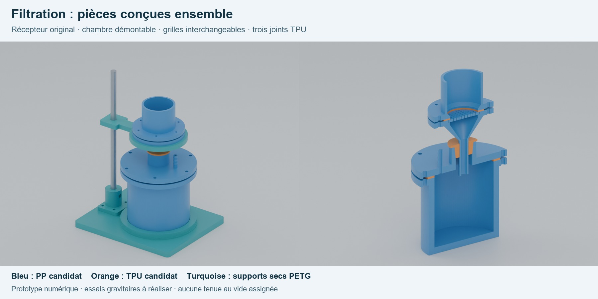

# Chimie et atelier — 80 CAO originales

*[English](README.md) · Français*

Une bibliothèque entièrement originale en STL, STEP et FreeCAD : **45 pièces d'atelier**, **10 récipients ouverts**, **8 outils d'immersion, de filtration et de préparation**, et **17 éléments de station de filtration**. Les Erlenmeyer et les modèles récupérés ne font pas partie de cette sélection.

Le système de filtration réunit le collecteur, une chambre démontable, deux grilles alternatives, un récepteur cylindrique conçu ici, ses couvercles, son berceau, un bras sur tige métallique et **trois joints TPU**. Un coupon permet de tester l'ajustement du TPU. [Montage, dimensions et liste d'achats](filtration/README.md).

**Ouvrir [catalogue.html](catalogue.html)** pour parcourir les 80 modèles, filtrer par série ou matière et accéder aux fichiers. [Catalogue Markdown](CATALOGUE.md), [données JSON](catalogue.json), [table CSV](catalogue.csv).

| Série | Contenu |
|---|---|
| Atelier | Portoirs tubes/flacons, potences pour entonnoirs, porte-pipettes, égouttoirs, supports de sondes, guides de tuyaux, plateaux, spatules, coupelles, étiquettes, jauges |
| Récipients ouverts | Béchers à bec de 100, 250, 500 et 1 000 mL nominaux ; cristallisoirs Ø90/140 ; entonnoirs liquides Ø60/90 et poudres Ø80/110 |
| Outils humides | Bain, panier perforé, porte-éprouvettes d'immersion, ancien filtre gravitaire et sa grille, coupelle de pesée, palette, bloc de rinçage à trois étapes |
| Filtration intégrée | FL01–FL17 : pièces en contact candidates au PP, joints TPU et bâti sec en PETG |

## Ce qui est vérifié

Les 80 STL ont une topologie fermée, un seul composant, des orientations cohérentes et un volume positif. Les STEP et FCStd ont été relus indépendamment : un solide valide par pièce. Chaque modèle tient individuellement dans 240 mm sur les trois axes ; le plus grand atteint 235 mm. Les contrôles d'assemblage de filtration ne détectent aucune collision rigide inattendue ; les deux interférences TPU prévues sont identifiées.

État au dépôt initial (21 novembre 2026) : modèles contrôlés numériquement, avant les premières impressions. Les retours d'impression et les résultats des essais serviront à corriger les cotes, les ajustements et les réglages. Les conditions d'utilisation sont détaillées dans les [notices de filtration](filtration/README.fr.md) et le guide des matériaux.

## Matières

| Type de pièce | Matière conseillée |
|---|---|
| Récipients et pièces de filtration en contact avec le liquide | PP |
| Supports, portoirs et rangements à sec | PETG |
| Joints souples | TPU |

Choisir le grade adapté à l'usage prévu en suivant le [guide des matériaux](recipients-chimiques/MATERIAUX.md) et la notice de chaque modèle.

## Imprimer et modifier

[Plan d'impression et régénération](IMPRESSION.md) · [Matériaux et limites machine](recipients-chimiques/MATERIAUX.md) · [Rapport STL](verification/mesh-report.json) · [Relecture STEP/FreeCAD](verification/cad-readback.json) · [Interfaces et collisions de filtration](filtration/verification/assemblages.json).

Les STL sont en millimètres. Les FCStd contiennent les solides CAO et des métadonnées ; la modification paramétrique se fait dans les sources Python/JSON FreeCAD, sans historique de fonctions esquissées. Aucun profil trancheur ni G-code n'est fourni. Les coupes PLY sont des illustrations non imprimables.

Toutes les créations sont attribuées à **nktrois**, sous [CC BY 4.0](LICENSE). Aucun modèle tiers n'est embarqué.
