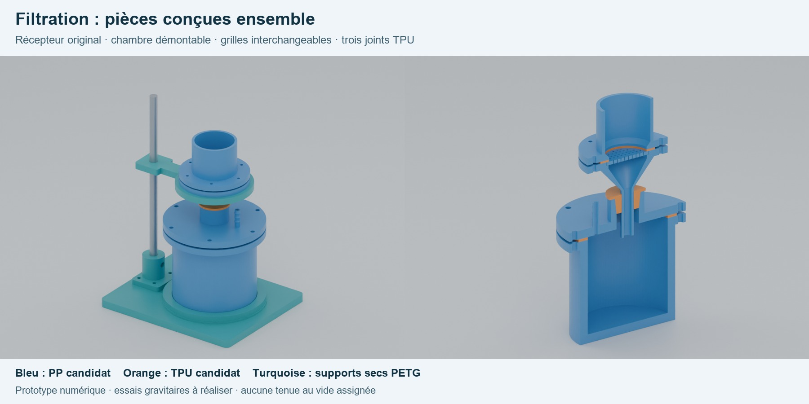

# Chemistry and workshop — 80 original CAD models

*English · [Français](README.fr.md)*

80 original parts with STL, STEP, native FreeCAD files and Python/JSON sources. Each part has its own folder, preview and English/French notices.

| Collection | Parts | Contents |
|---|---:|---|
| [Workshop and storage](originaux/) | 45 | Tube and bottle racks, stands, drying racks, hose guides, trays, scoops, labels and gauges |
| [Open vessels](recipients-chimiques/) | 10 | Pouring beakers, crystallizing dishes, liquid and powder funnels |
| [Immersion and preparation](outils-humides/) | 8 | Bath and basket, specimen holder, gravity filter, weigh boat, paddle and rinse block |
| [Filtration station](filtration/) | 17 | Collector, chamber, support discs, receiver, lids, three TPU seals and dry support parts |

[Illustrated catalogue](CATALOGUE.md) · [Offline searchable catalogue](catalogue.html) · [JSON](catalogue.json) · [CSV](catalogue.csv)

GitHub displays the Markdown catalogue. Download the collection and open `catalogue.html` locally to use its search and material filters.

## Files and settings

Each model folder contains its STL in millimetres, STEP, FCStd, `source.json`, `preview.jpg`, `README.md` and `README.fr.md`. Common generators remain under the relevant `scripts/` folder, linked from every notice. Parametric regeneration uses Python/JSON with FreeCAD. Native documents contain solids and metadata, without sketch-based feature histories.

See the [printing and regeneration guide](IMPRESSION.md) and the [material guide](recipients-chimiques/MATERIAUX.md). Technical documentation is in French.

## Verification and limits

All 80 meshes have closed, consistently oriented topology, one component and positive volume. STEP and FreeCAD readback confirms one valid solid per model. Each printable part fits within 240 mm on every axis; the largest dimension is 235 mm. [Mesh report](verification/mesh-report.json) · [CAD readback](verification/cad-readback.json).

These are digital prototypes. No physical printing, leak, chemical, thermal or vacuum tests have been performed. PP is a candidate for compatible wetted parts, PETG for dry supports, and TPU for compatible seals. Select the grade for the actual reagent, concentration, temperature and exposure time. No vacuum rating is assigned to the printed receiver or lids; initial filtration trials are gravity-fed with the vent open.

Original designs by **nktrois**, under [CC BY 4.0](LICENSE).
