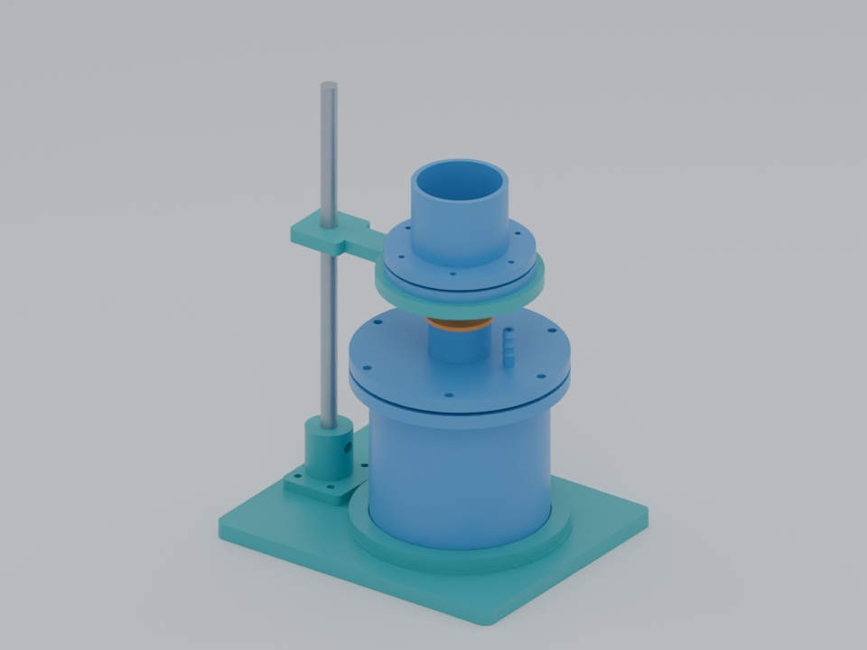
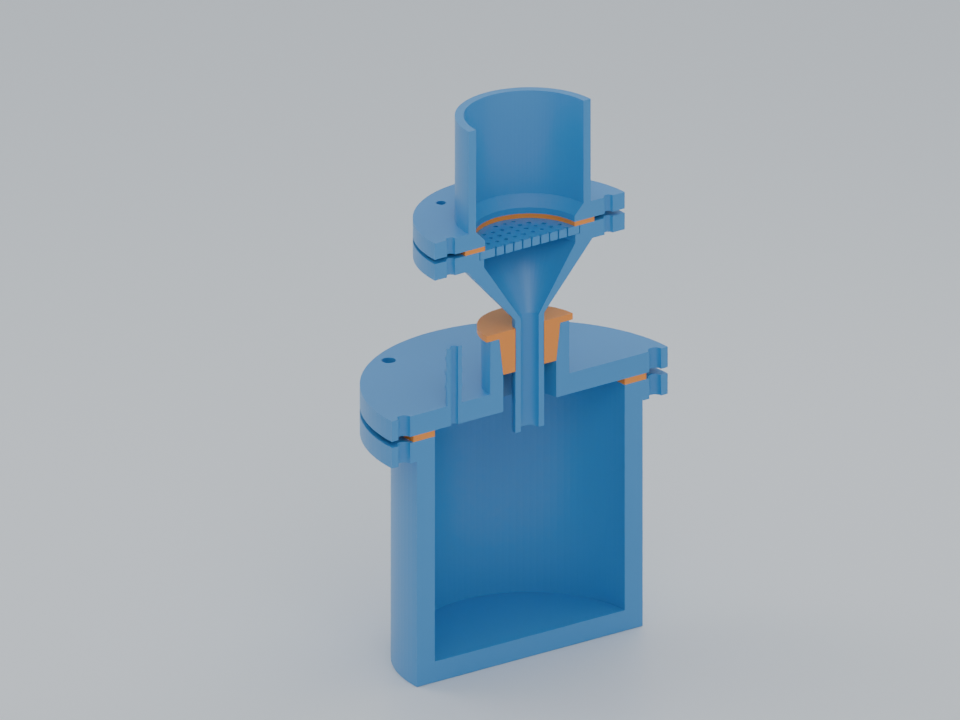
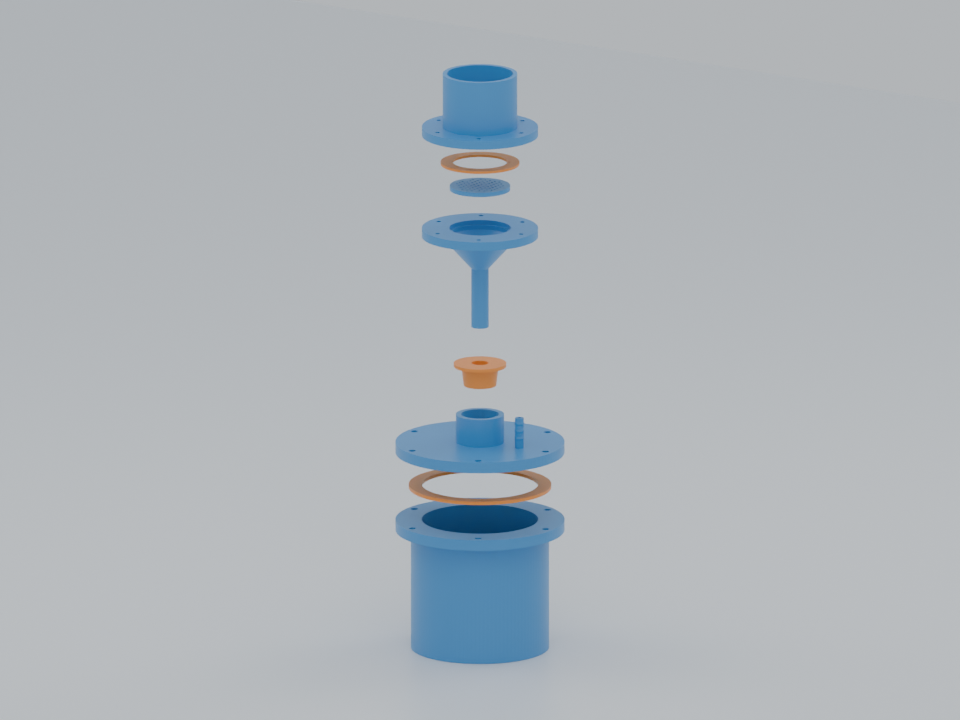
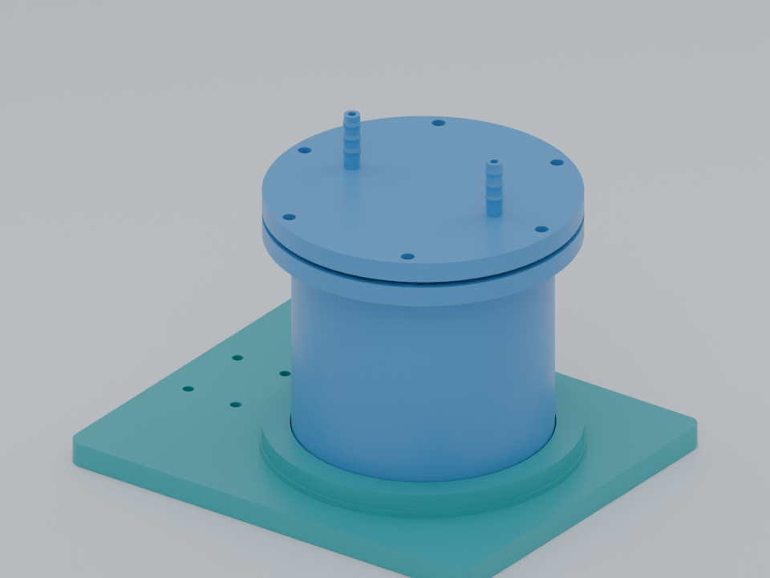

# Station de filtration originale — 17 pièces

*[English](README.md) · Français*

Le collecteur, sa chambre, le récepteur cylindrique, leurs couvercles et les joints ont été dessinés ensemble. Le récepteur est une création du dépôt. Les dimensions ne dépendent pas d'un flacon acheté. Cette série complète les outils d'immersion, de rinçage, de préparation et les récipients ouverts de la bibliothèque.

## Trois joints TPU

| Pièce | Fonction | Dimensions nominales |
|---|---|---|
| FL04 | Joint plat entre collecteur et chambre, au bord du papier | Ø72 extérieur / Ø50 intérieur × 2,2 mm |
| FL05 | Joint conique entre tige du filtre et col du récepteur | Alésage Ø15,6 pour tige Ø16 ; cône Ø29,8–34,2 sur 18 mm ; lèvre Ø48 |
| FL09 | Joint plat entre corps et couvercle du récepteur | Ø130 / Ø106 × 3 mm |
| FL16 | Coupon d'essai avant le joint conique | Trous Ø15,6 / 15,8 / 16 mm |

Les interférences diamétrales de 0,4 mm sur la tige et de 0,2 mm sur le cône sont intentionnelles dans la CAO. Le calcul de collision les identifie ; il ne prédit ni l'effort d'emmanchement ni la compression du vrai filament. Tester FL16 et corriger les cotes selon le grade, la dureté et le retrait mesurés.

Le TPU est une matière candidate pour fabriquer les joints, sans compatibilité chimique universelle. Les grades Desmopan peuvent gonfler ou se dégrader ; Covestro indique une résistance limitée aux acides et bases, les solutions concentrées pouvant les attaquer dès la température ambiante. Chaque joint doit donc être sélectionné pour le milieu réel, y compris vapeur et condensat. [Données du fabricant TPU](https://solutions.covestro.com/en/highlights/articles/theme/product-technology/chemical-properties-tpu).

## Corps de filtre et récepteur

FL01 est le collecteur inférieur à tige Ø16, passage Ø10. FL03 **ou** FL17 est son disque de support Ø55,2 × 4 dans une poche Ø56. Les trous de Ø2,2 ou Ø4 soutiennent un papier ou médium acheté : ils ne donnent pas une finesse de filtration équivalente à ces diamètres. Papier nominal Ø55 à vérifier selon sa référence ; le joint FL04 pince sa périphérie. Les ouvertures nominales de FL04 et du bas de FL02 sont Ø50.

FL02 forme une chambre ouverte Ø60, hauteur 50, avec une bride Ø106. Six vis M4 relient les deux brides. FL12 possède six accès Ø12 pour les écrous sous la bride. Aucun filetage imprimé n'est nécessaire.

FL06 est un récepteur démontable Ø126 extérieur / Ø106 intérieur, hauteur 120, fond 10, bride Ø154. Sa cavité cylindrique théorique vaut environ **971 mL jusqu'au bord**, sans réserve : ce chiffre n'est ni un volume utile validé ni une graduation de dosage. Le couvercle FL07 et le joint FL09 se fixent par six vis M6. Le col conique est dimensionné avec FL05. Le port latéral supérieur, passage Ø4, sert d'évent ouvert en configuration gravitaire.

L'opacité peut convenir à une réception simple ou à une filtration où l'on observe la chambre ouverte. Elle empêche de suivre directement le niveau dans FL06. Si la vue du liquide ou de la séparation de phases est nécessaire, employer un récepteur transparent approprié et redessiner son interface. Ne pas traiter FL06 comme un instrument de mesure de volume.

## Montage de référence

1. Tester les dimensions et l'état des surfaces avec des pièces propres et sèches ; commencer par FL16. Ébavurer sans abîmer les portées de joint. Les bavures ne doivent pas se détacher dans le liquide.
2. Fixer FL11 et FL13 à FL10. Utiliser des têtes fraisées 90° pour FL13 et vérifier qu'elles affleurent sous le récepteur. Poser quatre patins sous FL10 pour dégager les extrémités des vis. Insérer une tige **métallique** Ø12 × 300 dans FL11 et la bloquer avec la vis M5 et son écrou. Monter FL12 entre deux bagues commerciales de blocage de tige. La tige et les bagues ne sont pas des STL.
3. Poser FL06 dans FL13. Poser FL09 sur sa portée, puis FL07. Présenter les six M6 et répartir progressivement le serrage. Aucun couple de serrage ni taux de compression n'a été qualifié. Garder l'évent libre à l'atmosphère.
4. Enfiler FL05 sur la tige de FL01 ; placer son cône dans le col de FL07. Le bras FL12 soutient la face inférieure de la bride de FL01. Ne pas faire porter le poids du filtre sur le joint seul.
5. Poser FL03 ou FL17 dans sa poche, le papier compatible sur le disque, FL04 sur le bord du papier, puis FL02. Aligner les six perçages et monter les M4 avec rondelles et écrous. Ne pas combiner les deux disques dans la même poche.
6. Avant les réactifs, vérifier l'écoulement et les fuites avec un liquide d'essai inoffensif compatible, à température ambiante et sans aspiration. Contrôler aussi le basculement, le fluage des supports, la tenue des joints et la facilité de démontage. Aucun de ces essais physiques n'a encore été réalisé pour cette bibliothèque.

Repères de l'assemblage numérique : base z=0–12 ; fond du récepteur z=15 ; joint de couvercle z=135–138 ; couvercle à z=138 ; bas du collecteur à z=126 ; grille à z=215 ; joint du filtre à z=219 ; chambre à z=221,2. Ces positions sont des références CAO sans déformation du TPU. Ajuster la hauteur du bras selon l'assemblage imprimé.

## Quincaillerie et consommables à prévoir

Quantités pour **une station gravitaire**, à confirmer avec les épaisseurs imprimées, le type de tête et les rondelles choisis. Les métaux doivent aussi convenir à l'environnement de travail.

| À acheter séparément | Quantité | Emploi |
|---|---:|---|
| M4 × 25, écrous et rondelles | 6 jeux | Deux brides de filtre, empilement nominal 18,2 mm avant papier et rondelles |
| M6 × 35, écrous et rondelles | 6 jeux | Bride du récepteur + joint + couvercle : 23 mm nominaux |
| M5 × 20, écrous et rondelles | 4 jeux | Pied FL11 sur base FL10 ; écrous dans les logements sous la base |
| M5 × 16 à tête fraisée 90°, écrous et rondelles sous base | 4 jeux | Berceau FL13 sur base FL10 ; pas de rondelle sous la tête fraisée |
| M5 × 16 et écrou hexagonal | 1 jeu | Blocage de tige dans FL11 ; poche d'écrou ouverte sur le côté |
| Tige métallique Ø12 × 300 mm | 1 | Colonne de soutien |
| Bagues de blocage pour tige Ø12 | 2 | Maintien de la hauteur et retenue du bras FL12 |
| Patins antidérapants, hauteur au moins 3 mm | 4 | Sous FL10, dégagement des extrémités de vis et appui sur la table |
| Papier ou médium nominal Ø55 | Selon besoin | Compatibilité, rétention et tenue humide selon référence |
| PP pour les parties en contact ; TPU pour les joints ; PETG pour le bâti sec | Selon tranchage | Chaque pièce est imprimée séparément et assemblée |

Le guide FL14 est un accessoire extérieur à fixer à un support adapté, hors du passage des fluides. Ses trois passages sont Ø9,2 : choisir le tuyau sur son **diamètre extérieur**, ou modifier le guide. Les embouts FL07/FL08 sont Ø8 avec bourrelets Ø9 : le diamètre intérieur, la paroi et le serrage du tuyau doivent être vérifiés séparément. Un tuyau épais pour le vide peut dépasser Ø9,2 extérieur ; ne pas le forcer dans FL14.

## Extension aspiration : CAO fournie, usage non qualifié

FL08 est un **couvercle fermé à deux ports**, sans ouverture centrale, pour un deuxième corps FL06 avec un deuxième joint FL09. Le dessin fournit une base de prototype de piège de réception démontable. Il ne comporte pas de plongeur ni de clapet et son efficacité de séparation des gouttelettes n'a pas été mesurée. Son image et son assemblage STEP/FreeCAD sont fournis.

**Aucune dépression admissible n'est assignée à FL06, FL07, FL08 ou à leurs joints. Ne pas brancher ces corps imprimés non qualifiés à une pompe.** Une paroi épaisse et un STL fermé ne prouvent pas la résistance au flambage, aux couches poreuses ou au fluage. Les embouts ne sont pas des limiteurs de vide.

Pour réaliser ultérieurement une chaîne d'aspiration, il faut des récepteurs et pièges spécifiés pour le vide, des tuyaux adaptés aux produits et à la dépression, des raccords retenus, un réglage avec manomètre et remise à l'air, puis une pompe compatible avec les vapeurs. Adapter les interfaces CAO aux composants retenus. Ces éléments commerciaux ne sont pas fournis dans l'archive. La configuration conceptuelle est : filtre → réception → piège de protection → régulation/remise à l'air → pompe adaptée. DWK recommande un second flacon de protection en amont de la source de vide ; cela ne qualifie pas nos corps FDM. [Flacons de filtration DWK](https://www.dwk.com/wheaton-filter-flask).

## Impression et ajustements

Voir [le plan d'impression](../IMPRESSION.md). PP pour les surfaces mouillées seulement après sélection du grade et validation du procédé ; TPU pour les joints seulement après sélection chimique ; PETG pour le bâti sec. Les couleurs des rendus servent à identifier ces fonctions et ne prescrivent pas un colorant ou un grade.

Les sources [build_system_freecad.py](scripts/build_system_freecad.py) regroupent les dimensions communes dans `P`. [assemble_freecad.py](scripts/assemble_freecad.py) fournit les positions d'assemblage et les contrôles de collision. Une modification de dimension doit être répercutée dans les positions et vérifiée. Les fichiers FCStd contiennent des solides et leurs métadonnées, pas un historique de fonctions esquissées. La régénération paramétrique est faite par les scripts Python FreeCAD.

Les PLY de `illustrations/` sont des **coupes visuelles non imprimables**. Seuls les STL du catalogue sont les pièces à trancher. La tige métallique visible dans l'assemblage est une référence d'encombrement.
