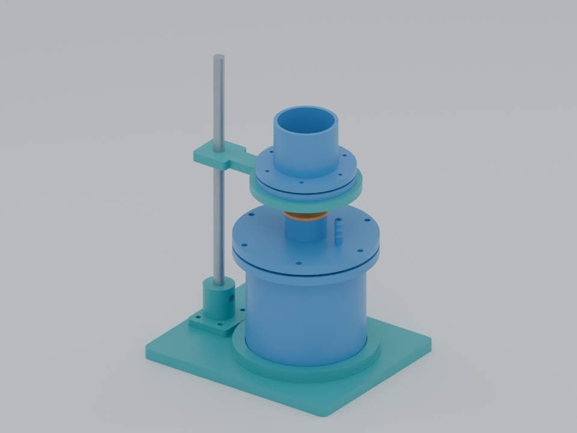
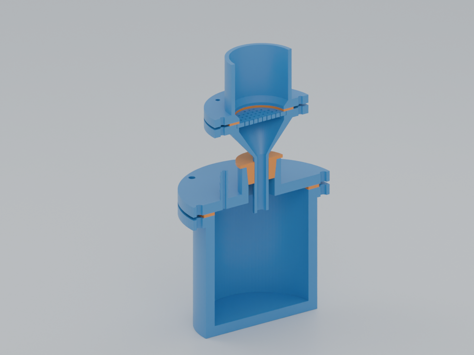

# Original filtration station — 17 parts

*English · [Français](README.fr.md)*

The filter, receiver and TPU seals were designed together. The cylindrical receiver is an original printed part, with a removable lid and cradle. The station uses a separate commercial Ø12 × 300 mm metal rod.

The three seals are FL04 (flat filter gasket), FL05 (tapered stem-to-receiver seal) and FL09 (receiver lid gasket). FL16 is a TPU fit-test coupon. FL03 and FL17 are alternative paper-support discs; filter paper is a separate consumable.

[Assembly, interfaces and hardware list in French](README.fr.md) · [Printing guide](../IMPRESSION.md) · [All parts](../CATALOGUE.md)

## Status

Initial release (21 November 2026): models checked digitally, before the first prints. Print feedback and test results will guide updates to dimensions, fits and printing settings. Initial setup: gravity-fed, vent open. Vacuum use of the printed receiver and lids has not been validated; see the [assembly notes](README.fr.md).

## Sources

[Shared dimensions and generators](scripts/build_system_freecad.py) · [Assembly positions and checks](scripts/assemble_freecad.py) · [Interfaces and collision report](verification/assemblages.json).

The PLY files in `illustrations/` are non-printable sections for visualization. The printable parts are the catalogued STL files in `modeles/`.
