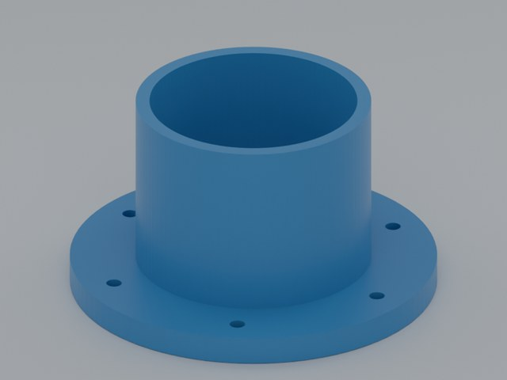

# FL02 — Chambre supérieure de filtration

*[English](README.md) · Français*

Chambre Ø60 mm, hauteur 50 mm ; bride commune avec FL01 ; ouvertures du filtre et du joint Ø50.

- Encombrement STL : **105.976 × 105.988 × 58 mm**.
- Matière candidate : **PP**.
- Interface : Chambre Ø60 mm, hauteur 50 mm ; bride commune avec FL01 ; ouvertures du filtre et du joint Ø50.
- Fichiers : [FL02.stl](FL02.stl), [FL02.step](FL02.step), [FL02.FCStd](FL02.FCStd).

Modèle original nktrois · [CC BY 4.0](../../../LICENSE). Contrôles numériques seulement ; aucune impression, étanchéité, tenue chimique, thermique ou au vide qualifiée.

[Plan d'impression](../../../IMPRESSION.md) · [Catalogue](../../../CATALOGUE.md) · [Montage de la station](../../../filtration/README.md)

## Sources et réglages

[Générateur FreeCAD](../../scripts/build_system_freecad.py) · [Paramètres de référence](source.json). Modifier les dimensions dans le générateur (`P` pour la filtration, `SPECS` pour les autres séries), puis régénérer. Le fichier `source.json` est un relevé des paramètres ; le générateur utilise les sources indiquées. Les FCStd contiennent un solide et ses métadonnées, sans historique de fonctions esquissées.
