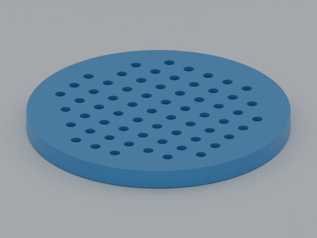

# FL03 — Grille de support papier Ø55

*[English](README.md) · Français*

Ø55,2 × 4 mm ; trous Ø2,2 ; support de papier, pas un filtre fin imprimé.

- Encombrement STL : **55.188 × 55.194 × 4 mm**.
- Matière candidate : **PP**.
- Interface : Ø55,2 × 4 mm ; trous Ø2,2 ; support de papier, pas un filtre fin imprimé.
- Fichiers : [FL03.stl](FL03.stl), [FL03.step](FL03.step), [FL03.FCStd](FL03.FCStd).

Modèle original nktrois · [CC BY 4.0](../../../LICENSE). État au dépôt initial (21 novembre 2026) : modèles contrôlés numériquement, avant les premières impressions. Les retours d'impression et les résultats des essais serviront à corriger les cotes, les ajustements et les réglages.

[Plan d'impression](../../../IMPRESSION.md) · [Catalogue](../../../CATALOGUE.md) · [Montage de la station](../../../filtration/README.md)

## Sources et réglages

[Générateur FreeCAD](../../scripts/build_system_freecad.py) · [Paramètres de référence](source.json). Modifier les dimensions dans le générateur (`P` pour la filtration, `SPECS` pour les autres séries), puis régénérer. Le fichier `source.json` est un relevé des paramètres ; le générateur utilise les sources indiquées. Les FCStd contiennent un solide et ses métadonnées, sans historique de fonctions esquissées.
