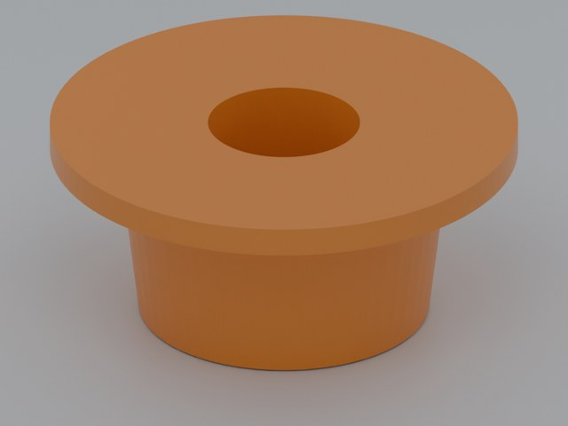

# FL05 — Joint conique tige–récepteur TPU

*[English](README.md) · Français*

Tige Ø16 dans alésage TPU Ø15,6 ; cône Ø29,8–34,2 dans col Ø29,6–34 ; interférences volontaires de conception.

- Encombrement STL : **47.989 × 47.995 × 20.88 mm**.
- Matière candidate : **TPU**.
- Interface : Tige Ø16 dans alésage TPU Ø15,6 ; cône Ø29,8–34,2 dans col Ø29,6–34 ; interférences volontaires de conception.
- Fichiers : [FL05.stl](FL05.stl), [FL05.step](FL05.step), [FL05.FCStd](FL05.FCStd).

Modèle original nktrois · [CC BY 4.0](../../../LICENSE). État au dépôt initial (21 novembre 2026) : modèles contrôlés numériquement, avant les premières impressions. Les retours d'impression et les résultats des essais serviront à corriger les cotes, les ajustements et les réglages.

[Plan d'impression](../../../IMPRESSION.md) · [Catalogue](../../../CATALOGUE.md) · [Montage de la station](../../../filtration/README.md)

## Sources et réglages

[Générateur FreeCAD](../../scripts/build_system_freecad.py) · [Paramètres de référence](source.json). Modifier les dimensions dans le générateur (`P` pour la filtration, `SPECS` pour les autres séries), puis régénérer. Le fichier `source.json` est un relevé des paramètres ; le générateur utilise les sources indiquées. Les FCStd contiennent un solide et ses métadonnées, sans historique de fonctions esquissées.
