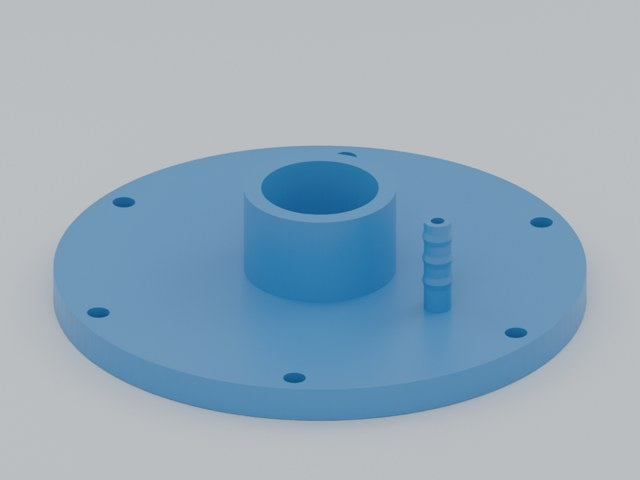

# FL07 — Couvercle de réception avec évent

*[English](README.md) · Français*

Col conique dimensionné avec FL05 ; port de diamètre intérieur 4 mm pour évent en mode gravitaire. Aspiration non qualifiée.

- Encombrement STL : **153.966 × 153.983 × 37.88 mm**.
- Matière candidate : **PP**.
- Interface : Col conique dimensionné avec FL05 ; port de diamètre intérieur 4 mm pour évent en mode gravitaire. Aspiration non qualifiée.
- Fichiers : [FL07.stl](FL07.stl), [FL07.step](FL07.step), [FL07.FCStd](FL07.FCStd).

Modèle original nktrois · [CC BY 4.0](../../../LICENSE). Contrôles numériques seulement ; aucune impression, étanchéité, tenue chimique, thermique ou au vide qualifiée.

[Plan d'impression](../../../IMPRESSION.md) · [Catalogue](../../../CATALOGUE.md) · [Montage de la station](../../../filtration/README.md)

## Sources et réglages

[Générateur FreeCAD](../../scripts/build_system_freecad.py) · [Paramètres de référence](source.json). Modifier les dimensions dans le générateur (`P` pour la filtration, `SPECS` pour les autres séries), puis régénérer. Le fichier `source.json` est un relevé des paramètres ; le générateur utilise les sources indiquées. Les FCStd contiennent un solide et ses métadonnées, sans historique de fonctions esquissées.
