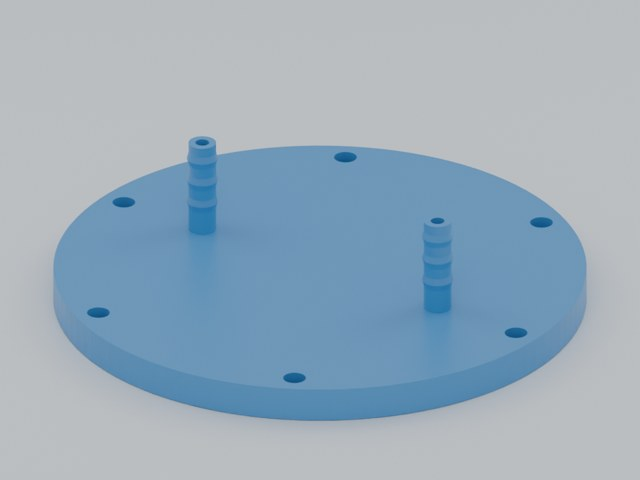

# FL08 — Couvercle deux ports pour prototype de piège

*[English](README.md) · Français*

Deux embouts OD8 à bourrelets Ø9, passage Ø4. Réutilise FL06 et FL09 ; aucune efficacité de piège ou tenue au vide prouvée.

- Encombrement STL : **153.966 × 153.983 × 37.88 mm**.
- Matière candidate : **PP**.
- Interface : Deux embouts OD8 à bourrelets Ø9, passage Ø4. Réutilise FL06 et FL09 ; aucune efficacité de piège ou tenue au vide prouvée.
- Fichiers : [FL08.stl](FL08.stl), [FL08.step](FL08.step), [FL08.FCStd](FL08.FCStd).

Modèle original nktrois · [CC BY 4.0](../../../LICENSE). Contrôles numériques seulement ; aucune impression, étanchéité, tenue chimique, thermique ou au vide qualifiée.

[Plan d'impression](../../../IMPRESSION.md) · [Catalogue](../../../CATALOGUE.md) · [Montage de la station](../../../filtration/README.md)

## Sources et réglages

[Générateur FreeCAD](../../scripts/build_system_freecad.py) · [Paramètres de référence](source.json). Modifier les dimensions dans le générateur (`P` pour la filtration, `SPECS` pour les autres séries), puis régénérer. Le fichier `source.json` est un relevé des paramètres ; le générateur utilise les sources indiquées. Les FCStd contiennent un solide et ses métadonnées, sans historique de fonctions esquissées.
