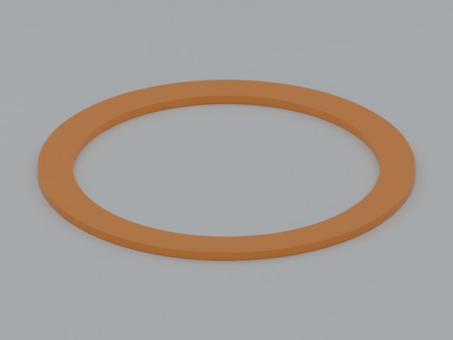

# FL09 — Joint de couvercle du récepteur TPU

*[English](README.md) · Français*

Ø130 / Ø106 × 3 mm ; compression et compatibilité réelles à qualifier ; six boulons M6 extérieurs au joint.

- Encombrement STL : **129.971 × 129.985 × 3 mm**.
- Matière candidate : **TPU**.
- Interface : Ø130 / Ø106 × 3 mm ; compression et compatibilité réelles à qualifier ; six boulons M6 extérieurs au joint.
- Fichiers : [FL09.stl](FL09.stl), [FL09.step](FL09.step), [FL09.FCStd](FL09.FCStd).

Modèle original nktrois · [CC BY 4.0](../../../LICENSE). Contrôles numériques seulement ; aucune impression, étanchéité, tenue chimique, thermique ou au vide qualifiée.

[Plan d'impression](../../../IMPRESSION.md) · [Catalogue](../../../CATALOGUE.md) · [Montage de la station](../../../filtration/README.md)

## Sources et réglages

[Générateur FreeCAD](../../scripts/build_system_freecad.py) · [Paramètres de référence](source.json). Modifier les dimensions dans le générateur (`P` pour la filtration, `SPECS` pour les autres séries), puis régénérer. Le fichier `source.json` est un relevé des paramètres ; le générateur utilise les sources indiquées. Les FCStd contiennent un solide et ses métadonnées, sans historique de fonctions esquissées.
