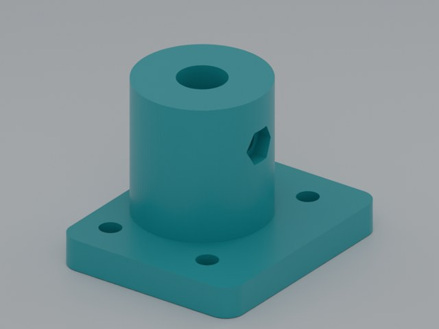

# FL11 — Pied de tige métallique Ø12

*[English](README.md) · Français*

Quatre vis M5 ; logement Ø12,4 ; vis de blocage à écrou ou insert adapté. Tige métallique et fixation non fournies.

- Encombrement STL : **50 × 60 × 42.88 mm**.
- Matière candidate : **PETG**.
- Interface : Quatre vis M5 ; logement Ø12,4 ; vis de blocage à écrou ou insert adapté. Tige métallique et fixation non fournies.
- Fichiers : [FL11.stl](FL11.stl), [FL11.step](FL11.step), [FL11.FCStd](FL11.FCStd).

Modèle original nktrois · [CC BY 4.0](../../../LICENSE). Contrôles numériques seulement ; aucune impression, étanchéité, tenue chimique, thermique ou au vide qualifiée.

[Plan d'impression](../../../IMPRESSION.md) · [Catalogue](../../../CATALOGUE.md) · [Montage de la station](../../../filtration/README.md)

## Sources et réglages

[Générateur FreeCAD](../../scripts/build_system_freecad.py) · [Paramètres de référence](source.json). Modifier les dimensions dans le générateur (`P` pour la filtration, `SPECS` pour les autres séries), puis régénérer. Le fichier `source.json` est un relevé des paramètres ; le générateur utilise les sources indiquées. Les FCStd contiennent un solide et ses métadonnées, sans historique de fonctions esquissées.
