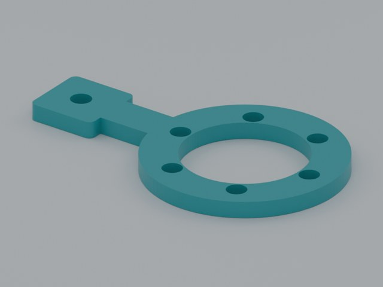

# FL12 — Bras de soutien sous bride

*[English](README.md) · Français*

Anneau ID74/OD118 ; déport d'axe 112 mm ; logement de tige Ø12,4 ; deux bagues de blocage de tige commerciales nécessaires.

- Encombrement STL : **191 × 117.991 × 10 mm**.
- Matière candidate : **PETG**.
- Interface : Anneau ID74/OD118 ; déport d'axe 112 mm ; logement de tige Ø12,4 ; deux bagues de blocage de tige commerciales nécessaires.
- Fichiers : [FL12.stl](FL12.stl), [FL12.step](FL12.step), [FL12.FCStd](FL12.FCStd).

Modèle original nktrois · [CC BY 4.0](../../../LICENSE). État au dépôt initial (21 novembre 2026) : modèles contrôlés numériquement, avant les premières impressions. Les retours d'impression et les résultats des essais serviront à corriger les cotes, les ajustements et les réglages.

[Plan d'impression](../../../IMPRESSION.md) · [Catalogue](../../../CATALOGUE.md) · [Montage de la station](../../../filtration/README.md)

## Sources et réglages

[Générateur FreeCAD](../../scripts/build_system_freecad.py) · [Paramètres de référence](source.json). Modifier les dimensions dans le générateur (`P` pour la filtration, `SPECS` pour les autres séries), puis régénérer. Le fichier `source.json` est un relevé des paramètres ; le générateur utilise les sources indiquées. Les FCStd contiennent un solide et ses métadonnées, sans historique de fonctions esquissées.
