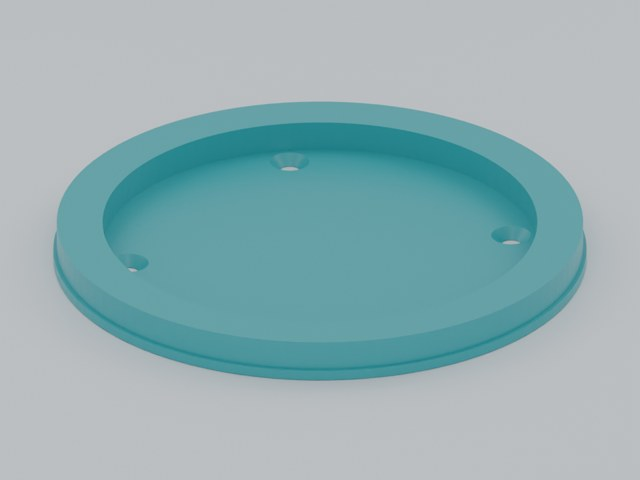

# FL13 — Berceau du récepteur

*[English](README.md) · Français*

Logement Ø127,2 pour corps Ø126 ; quatre vis M5 à tête fraisée 90° vers FL10, têtes affleurantes ; il ne remplace pas une évaluation de stabilité.

- Encombrement STL : **155.965 × 155.983 × 11.88 mm**.
- Matière candidate : **PETG**.
- Interface : Logement Ø127,2 pour corps Ø126 ; quatre vis M5 à tête fraisée 90° vers FL10, têtes affleurantes ; il ne remplace pas une évaluation de stabilité.
- Fichiers : [FL13.stl](FL13.stl), [FL13.step](FL13.step), [FL13.FCStd](FL13.FCStd).

Modèle original nktrois · [CC BY 4.0](../../../LICENSE). État au dépôt initial (21 novembre 2026) : modèles contrôlés numériquement, avant les premières impressions. Les retours d'impression et les résultats des essais serviront à corriger les cotes, les ajustements et les réglages.

[Plan d'impression](../../../IMPRESSION.md) · [Catalogue](../../../CATALOGUE.md) · [Montage de la station](../../../filtration/README.md)

## Sources et réglages

[Générateur FreeCAD](../../scripts/build_system_freecad.py) · [Paramètres de référence](source.json). Modifier les dimensions dans le générateur (`P` pour la filtration, `SPECS` pour les autres séries), puis régénérer. Le fichier `source.json` est un relevé des paramètres ; le générateur utilise les sources indiquées. Les FCStd contiennent un solide et ses métadonnées, sans historique de fonctions esquissées.
