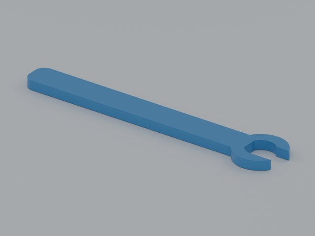

# FL15 — Support-disc lifting hook

*English · [Français](README.fr.md)*

## Files

- [FL15.stl](FL15.stl): printable mesh in millimetres.
- [FL15.step](FL15.step): CAD exchange solid.
- [FL15.FCStd](FL15.FCStd): native FreeCAD solid and metadata.
- [source.json](source.json): dimensions and source references.

Envelope: **115.247 × 21.999 × 4 mm**. Detailed interface notes are available in the [French notice](README.fr.md).

## Printing

Material candidate: **PP**, selected for the actual use. See the [printing guide](../../../IMPRESSION.md) for orientation and fit checks. No slicer profile or G-code is included.

## Settings

[FreeCAD generator](../../scripts/build_system_freecad.py). Edit the generator dimensions (`P` for filtration, `SPECS` for the other series) and regenerate. The `source.json` file is a parameter reference; edit the listed generator inputs. FCStd files contain solids and metadata, without a sketch-based feature history.

## Status

Original digital prototype by **nktrois**, under [CC BY 4.0](../../../LICENSE). Numerically checked geometry; not physically printed or qualified for leak tightness, chemical exposure, heating or vacuum service. Check the exact material grade and intended conditions before use.

[Collection](../../../README.md) · [Illustrated catalogue](../../../CATALOGUE.md)
 · [Filtration assembly](../../../filtration/README.md)
