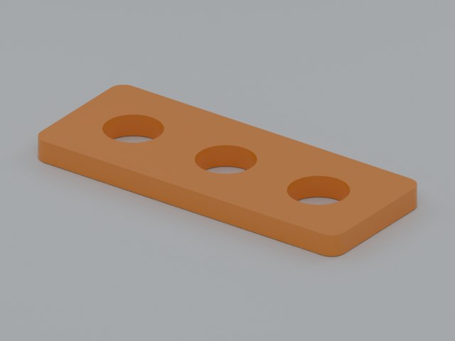

# FL16 — Coupon TPU d'ajustement de tige

*[English](README.md) · Français*

Trois trous Ø15,6 / 15,8 / 16 mm pour tester le vrai filament avant le joint conique complet.

- Encombrement STL : **95 × 38 × 6 mm**.
- Matière candidate : **TPU**.
- Interface : Trois trous Ø15,6 / 15,8 / 16 mm pour tester le vrai filament avant le joint conique complet.
- Fichiers : [FL16.stl](FL16.stl), [FL16.step](FL16.step), [FL16.FCStd](FL16.FCStd).

Modèle original nktrois · [CC BY 4.0](../../../LICENSE). Contrôles numériques seulement ; aucune impression, étanchéité, tenue chimique, thermique ou au vide qualifiée.

[Plan d'impression](../../../IMPRESSION.md) · [Catalogue](../../../CATALOGUE.md) · [Montage de la station](../../../filtration/README.md)

## Sources et réglages

[Générateur FreeCAD](../../scripts/build_system_freecad.py) · [Paramètres de référence](source.json). Modifier les dimensions dans le générateur (`P` pour la filtration, `SPECS` pour les autres séries), puis régénérer. Le fichier `source.json` est un relevé des paramètres ; le générateur utilise les sources indiquées. Les FCStd contiennent un solide et ses métadonnées, sans historique de fonctions esquissées.
