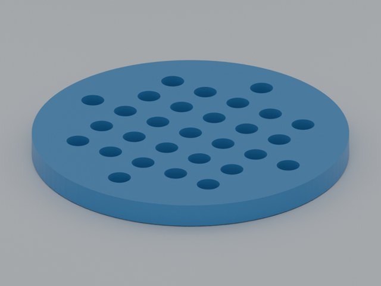

# FL17 — Grille de support alternative ajourée

*[English](README.md) · Français*

Même interface Ø55,2 × 4 mm ; trous Ø4 ; support de médium, pas de granulométrie de filtration garantie.

- Encombrement STL : **55.188 × 55.194 × 4 mm**.
- Matière candidate : **PP**.
- Interface : Même interface Ø55,2 × 4 mm ; trous Ø4 ; support de médium, pas de granulométrie de filtration garantie.
- Fichiers : [FL17.stl](FL17.stl), [FL17.step](FL17.step), [FL17.FCStd](FL17.FCStd).

Modèle original nktrois · [CC BY 4.0](../../../LICENSE). Contrôles numériques seulement ; aucune impression, étanchéité, tenue chimique, thermique ou au vide qualifiée.

[Plan d'impression](../../../IMPRESSION.md) · [Catalogue](../../../CATALOGUE.md) · [Montage de la station](../../../filtration/README.md)

## Sources et réglages

[Générateur FreeCAD](../../scripts/build_system_freecad.py) · [Paramètres de référence](source.json). Modifier les dimensions dans le générateur (`P` pour la filtration, `SPECS` pour les autres séries), puis régénérer. Le fichier `source.json` est un relevé des paramètres ; le générateur utilise les sources indiquées. Les FCStd contiennent un solide et ses métadonnées, sans historique de fonctions esquissées.
