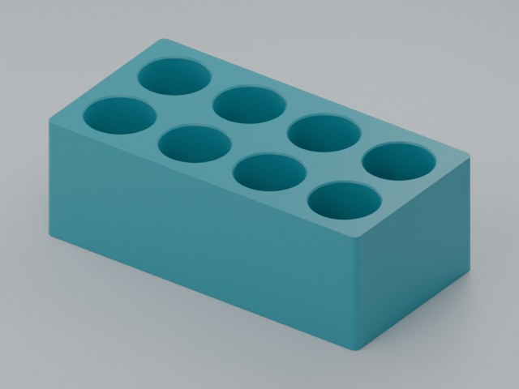

# R05 — Portoir 8 tubes coniques 50 mL

*[English](README.md) · Français*

Maintenir 8 tubes commerciaux de 50 mL au repos, hors centrifugeuse.

- Encombrement STL : **161.8 × 83.8 × 56 mm**.
- Matière candidate : **PETG**.
- Interface : Puits Ø 30.8 mm ; mesurer le diamètre extérieur du récipient.
- Fichiers : [R05.stl](R05.stl), [R05.step](R05.step), [R05.FCStd](R05.FCStd).

Modèle original nktrois · [CC BY 4.0](../../../LICENSE). État au dépôt initial (21 novembre 2026) : modèles contrôlés numériquement, avant les premières impressions. Les retours d'impression et les résultats des essais serviront à corriger les cotes, les ajustements et les réglages.

[Plan d'impression](../../../IMPRESSION.md) · [Catalogue](../../../CATALOGUE.md)

## Sources et réglages

[Générateur FreeCAD](../../../scripts/build_freecad.py) · [Paramètres de référence](source.json). Modifier la ligne de cette pièce dans [catalogue-base.json](../../../catalogue-base.json), puis régénérer. Le fichier `source.json` est un relevé des paramètres ; le générateur utilise les sources indiquées. Les FCStd contiennent un solide et ses métadonnées, sans historique de fonctions esquissées.
