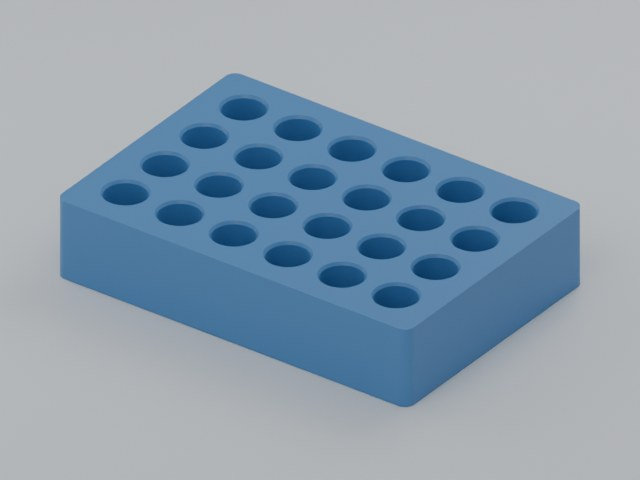

# R06 — Portoir 24 microtubes

*[English](README.md) · Français*

Ranger 24 microtubes commerciaux ; vérifier la géométrie de leur collerette.

- Encombrement STL : **110.6 × 76.6 × 23 mm**.
- Matière candidate : **PETG**.
- Interface : Puits Ø 11.6 mm ; mesurer le diamètre extérieur du récipient.
- Fichiers : [R06.stl](R06.stl), [R06.step](R06.step), [R06.FCStd](R06.FCStd).

Modèle original nktrois · [CC BY 4.0](../../../LICENSE). Contrôles numériques seulement ; aucune impression, étanchéité, tenue chimique, thermique ou au vide qualifiée.

[Plan d'impression](../../../IMPRESSION.md) · [Catalogue](../../../CATALOGUE.md)

## Sources et réglages

[Générateur FreeCAD](../../../scripts/build_freecad.py) · [Paramètres de référence](source.json). Modifier la ligne de cette pièce dans [catalogue-base.json](../../../catalogue-base.json), puis régénérer. Le fichier `source.json` est un relevé des paramètres ; le générateur utilise les sources indiquées. Les FCStd contiennent un solide et ses métadonnées, sans historique de fonctions esquissées.
