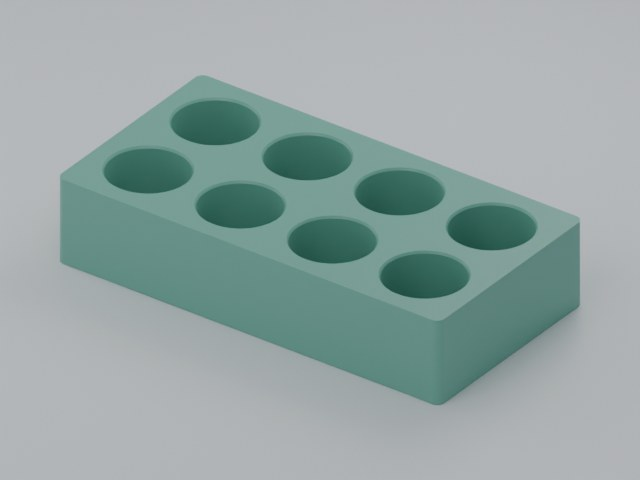

# R08 — Portoir 8 flacons Ø28

*[English](README.md) · Français*

Organiser 8 flacons secs de diamètre extérieur voisin de 28 mm.

- Encombrement STL : **153.8 × 79.8 × 32 mm**.
- Matière candidate : **PETG**.
- Interface : Puits Ø 28.8 mm ; mesurer le diamètre extérieur du récipient.
- Fichiers : [R08.stl](R08.stl), [R08.step](R08.step), [R08.FCStd](R08.FCStd).

Modèle original nktrois · [CC BY 4.0](../../../LICENSE). Contrôles numériques seulement ; aucune impression, étanchéité, tenue chimique, thermique ou au vide qualifiée.

[Plan d'impression](../../../IMPRESSION.md) · [Catalogue](../../../CATALOGUE.md)

## Sources et réglages

[Générateur FreeCAD](../../../scripts/build_freecad.py) · [Paramètres de référence](source.json). Modifier la ligne de cette pièce dans [catalogue-base.json](../../../catalogue-base.json), puis régénérer. Le fichier `source.json` est un relevé des paramètres ; le générateur utilise les sources indiquées. Les FCStd contiennent un solide et ses métadonnées, sans historique de fonctions esquissées.
