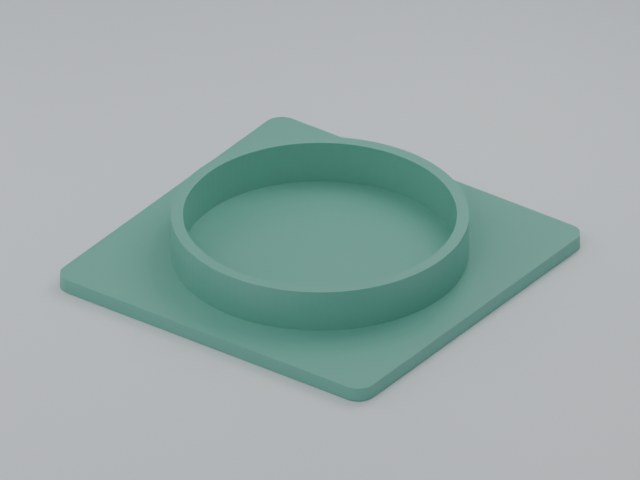

# B04 — Socle verrerie Ø90

*[English](README.md) · Français*

Positionner un récipient commercial à température ambiante ; aucune garantie contre le renversement.

- Encombrement STL : **127 × 127 × 19.9 mm**.
- Matière candidate : **PETG**.
- Interface : Diamètre intérieur du collier : 91 mm.
- Fichiers : [B04.stl](B04.stl), [B04.step](B04.step), [B04.FCStd](B04.FCStd).

Modèle original nktrois · [CC BY 4.0](../../../LICENSE). État au dépôt initial (21 novembre 2026) : modèles contrôlés numériquement, avant les premières impressions. Les retours d'impression et les résultats des essais serviront à corriger les cotes, les ajustements et les réglages.

[Plan d'impression](../../../IMPRESSION.md) · [Catalogue](../../../CATALOGUE.md)

## Sources et réglages

[Générateur FreeCAD](../../../scripts/build_freecad.py) · [Paramètres de référence](source.json). Modifier la ligne de cette pièce dans [catalogue-base.json](../../../catalogue-base.json), puis régénérer. Le fichier `source.json` est un relevé des paramètres ; le générateur utilise les sources indiquées. Les FCStd contiennent un solide et ses métadonnées, sans historique de fonctions esquissées.
