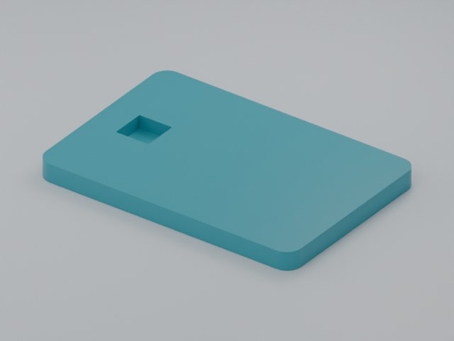

# F01 — Socle de potence légère

*[English](README.md) · Français*

Socle pour le support léger d'entonnoir F02/F03/F04 ; pas une potence de laboratoire porteuse.

- Encombrement STL : **160 × 110 × 11 mm**.
- Matière candidate : **PETG**.
- Interface : Emboîtement carré 20,4 mm ; assemblage F01 + F02 + F03 ou F04.
- Fichiers : [F01.stl](F01.stl), [F01.step](F01.step), [F01.FCStd](F01.FCStd).

Modèle original nktrois · [CC BY 4.0](../../../LICENSE). État au dépôt initial (21 novembre 2026) : modèles contrôlés numériquement, avant les premières impressions. Les retours d'impression et les résultats des essais serviront à corriger les cotes, les ajustements et les réglages.

[Plan d'impression](../../../IMPRESSION.md) · [Catalogue](../../../CATALOGUE.md)

## Sources et réglages

[Générateur FreeCAD](../../../scripts/build_freecad.py) · [Paramètres de référence](source.json). Modifier la ligne de cette pièce dans [catalogue-base.json](../../../catalogue-base.json), puis régénérer. Le fichier `source.json` est un relevé des paramètres ; le générateur utilise les sources indiquées. Les FCStd contiennent un solide et ses métadonnées, sans historique de fonctions esquissées.
