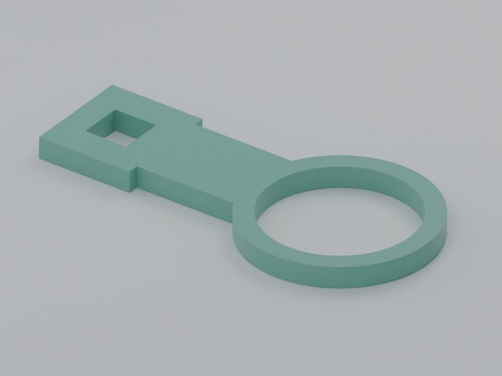

# F04 — Bras porte-entonnoir Ø55

*[English](README.md) · Français*

Maintenir un petit entonnoir commercial vide ; vérifier la stabilité avec le récipient récepteur avant tout usage.

- Encombrement STL : **139.5 × 68.979 × 8 mm**.
- Matière candidate : **PETG**.
- Interface : Passage central Ø 55 mm ; montage sur le tenon supérieur de F02.
- Fichiers : [F04.stl](F04.stl), [F04.step](F04.step), [F04.FCStd](F04.FCStd).

Modèle original nktrois · [CC BY 4.0](../../../LICENSE). État au dépôt initial (21 novembre 2026) : modèles contrôlés numériquement, avant les premières impressions. Les retours d'impression et les résultats des essais serviront à corriger les cotes, les ajustements et les réglages.

[Plan d'impression](../../../IMPRESSION.md) · [Catalogue](../../../CATALOGUE.md)

## Sources et réglages

[Générateur FreeCAD](../../../scripts/build_freecad.py) · [Paramètres de référence](source.json). Modifier la ligne de cette pièce dans [catalogue-base.json](../../../catalogue-base.json), puis régénérer. Le fichier `source.json` est un relevé des paramètres ; le générateur utilise les sources indiquées. Les FCStd contiennent un solide et ses métadonnées, sans historique de fonctions esquissées.
