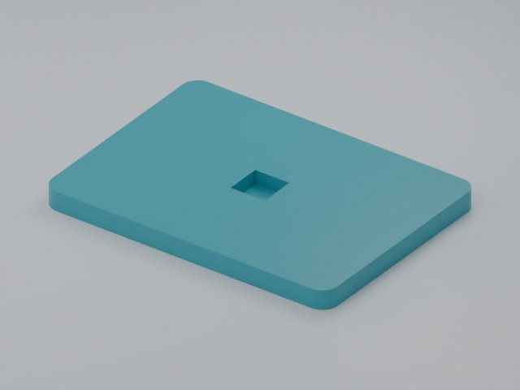

# P01 — Socle porte-pipettes

*[English](README.md) · Français*

Base du porte-pipettes P01/P02/P03 ; rangement à sec uniquement.

- Encombrement STL : **170 × 125 × 11 mm**.
- Matière candidate : **PETG**.
- Interface : Assemblage P01 + P02 + P03.
- Fichiers : [P01.stl](P01.stl), [P01.step](P01.step), [P01.FCStd](P01.FCStd).

Modèle original nktrois · [CC BY 4.0](../../../LICENSE). Contrôles numériques seulement ; aucune impression, étanchéité, tenue chimique, thermique ou au vide qualifiée.

[Plan d'impression](../../../IMPRESSION.md) · [Catalogue](../../../CATALOGUE.md)

## Sources et réglages

[Générateur FreeCAD](../../../scripts/build_freecad.py) · [Paramètres de référence](source.json). Modifier la ligne de cette pièce dans [catalogue-base.json](../../../catalogue-base.json), puis régénérer. Le fichier `source.json` est un relevé des paramètres ; le générateur utilise les sources indiquées. Les FCStd contiennent un solide et ses métadonnées, sans historique de fonctions esquissées.
