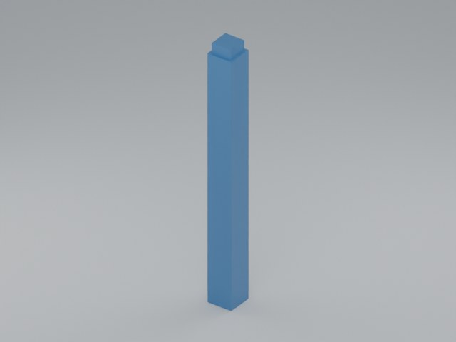

# P02 — Colonne porte-pipettes 190 mm

*[English](README.md) · Français*

Colonne du porte-pipettes, sans charge instrumentale lourde.

- Encombrement STL : **20 × 20 × 205.9 mm**.
- Matière candidate : **PETG**.
- Interface : Même interface que F02 ; hauteur totale 206 mm.
- Fichiers : [P02.stl](P02.stl), [P02.step](P02.step), [P02.FCStd](P02.FCStd).

Modèle original nktrois · [CC BY 4.0](../../../LICENSE). Contrôles numériques seulement ; aucune impression, étanchéité, tenue chimique, thermique ou au vide qualifiée.

[Plan d'impression](../../../IMPRESSION.md) · [Catalogue](../../../CATALOGUE.md)

## Sources et réglages

[Générateur FreeCAD](../../../scripts/build_freecad.py) · [Paramètres de référence](source.json). Modifier la ligne de cette pièce dans [catalogue-base.json](../../../catalogue-base.json), puis régénérer. Le fichier `source.json` est un relevé des paramètres ; le générateur utilise les sources indiquées. Les FCStd contiennent un solide et ses métadonnées, sans historique de fonctions esquissées.
