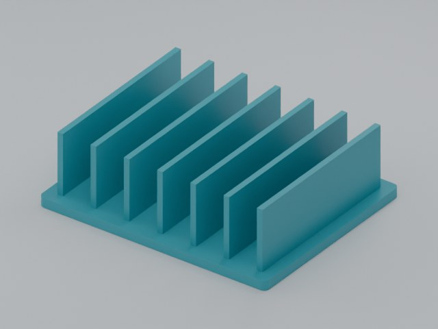

# D02 — Égouttoir 6 couvercles

*[English](README.md) · Français*

Ranger ou égoutter 6 couvercles et verres de montre déjà rincés à l'eau.

- Encombrement STL : **123 × 100 × 36.9 mm**.
- Matière candidate : **PETG**.
- Interface : 6 intervalles de 15 mm.
- Fichiers : [D02.stl](D02.stl), [D02.step](D02.step), [D02.FCStd](D02.FCStd).

Modèle original nktrois · [CC BY 4.0](../../../LICENSE). Contrôles numériques seulement ; aucune impression, étanchéité, tenue chimique, thermique ou au vide qualifiée.

[Plan d'impression](../../../IMPRESSION.md) · [Catalogue](../../../CATALOGUE.md)

## Sources et réglages

[Générateur FreeCAD](../../../scripts/build_freecad.py) · [Paramètres de référence](source.json). Modifier la ligne de cette pièce dans [catalogue-base.json](../../../catalogue-base.json), puis régénérer. Le fichier `source.json` est un relevé des paramètres ; le générateur utilise les sources indiquées. Les FCStd contiennent un solide et ses métadonnées, sans historique de fonctions esquissées.
