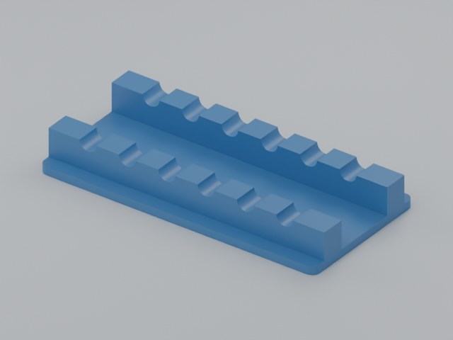

# D03 — Support 6 tiges de verre

*[English](README.md) · Français*

Poser horizontalement des tiges de verre propres et froides.

- Encombrement STL : **140 × 70 × 17.9 mm**.
- Matière candidate : **PETG**.
- Interface : Gorges Ø 8,6 mm, entraxe 20 mm.
- Fichiers : [D03.stl](D03.stl), [D03.step](D03.step), [D03.FCStd](D03.FCStd).

Modèle original nktrois · [CC BY 4.0](../../../LICENSE). État au dépôt initial (21 novembre 2026) : modèles contrôlés numériquement, avant les premières impressions. Les retours d'impression et les résultats des essais serviront à corriger les cotes, les ajustements et les réglages.

[Plan d'impression](../../../IMPRESSION.md) · [Catalogue](../../../CATALOGUE.md)

## Sources et réglages

[Générateur FreeCAD](../../../scripts/build_freecad.py) · [Paramètres de référence](source.json). Modifier la ligne de cette pièce dans [catalogue-base.json](../../../catalogue-base.json), puis régénérer. Le fichier `source.json` est un relevé des paramètres ; le générateur utilise les sources indiquées. Les FCStd contiennent un solide et ses métadonnées, sans historique de fonctions esquissées.
