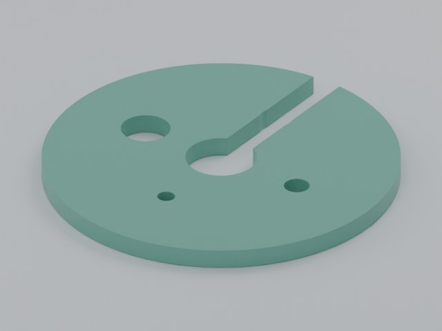

# C02 — Plaque ouverte porte-sondes Ø90

*[English](README.md) · Français*

Positionner des sondes sur un récipient à froid après vérification des dimensions et de la compatibilité ; plaque ouverte non étanche.

- Encombrement STL : **90 × 89.802 × 5 mm**.
- Matière candidate : **PETG**.
- Interface : Passages Ø 6,5 / 8,5 / 12,5 / 4,5 mm et évent central. Ne sert pas de fermeture sous pression.
- Fichiers : [C02.stl](C02.stl), [C02.step](C02.step), [C02.FCStd](C02.FCStd).

Modèle original nktrois · [CC BY 4.0](../../../LICENSE). Contrôles numériques seulement ; aucune impression, étanchéité, tenue chimique, thermique ou au vide qualifiée.

[Plan d'impression](../../../IMPRESSION.md) · [Catalogue](../../../CATALOGUE.md)

## Sources et réglages

[Générateur FreeCAD](../../../scripts/build_freecad.py) · [Paramètres de référence](source.json). Modifier la ligne de cette pièce dans [catalogue-base.json](../../../catalogue-base.json), puis régénérer. Le fichier `source.json` est un relevé des paramètres ; le générateur utilise les sources indiquées. Les FCStd contiennent un solide et ses métadonnées, sans historique de fonctions esquissées.
