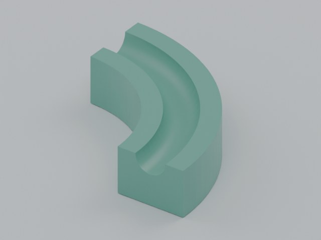

# T03 — Guide courbe 90° tuyau Ø6.8

*[English](README.md) · Français*

Accompagner un tuyau souple dans un virage à 90°, sans fonction de raccord ni d'étanchéité.

- Encombrement STL : **37.4 × 37.4 × 10 mm**.
- Matière candidate : **PETG**.
- Interface : Rayon de ligne médiane 30 mm ; vérifier le rayon de courbure minimal du tuyau.
- Fichiers : [T03.stl](T03.stl), [T03.step](T03.step), [T03.FCStd](T03.FCStd).

Modèle original nktrois · [CC BY 4.0](../../../LICENSE). Contrôles numériques seulement ; aucune impression, étanchéité, tenue chimique, thermique ou au vide qualifiée.

[Plan d'impression](../../../IMPRESSION.md) · [Catalogue](../../../CATALOGUE.md)

## Sources et réglages

[Générateur FreeCAD](../../../scripts/build_freecad.py) · [Paramètres de référence](source.json). Modifier la ligne de cette pièce dans [catalogue-base.json](../../../catalogue-base.json), puis régénérer. Le fichier `source.json` est un relevé des paramètres ; le générateur utilise les sources indiquées. Les FCStd contiennent un solide et ses métadonnées, sans historique de fonctions esquissées.
