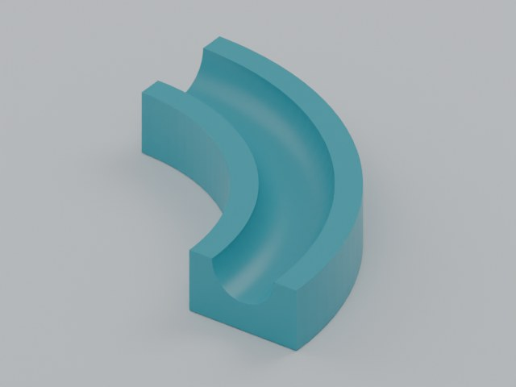

# T04 — Guide courbe 90° tuyau Ø10.8

*[English](README.md) · Français*

Accompagner un tuyau souple dans un virage à 90°, sans fonction de raccord ni d'étanchéité.

- Encombrement STL : **49.4 × 49.4 × 10 mm**.
- Matière candidate : **PETG**.
- Interface : Rayon de ligne médiane 40 mm ; vérifier le rayon de courbure minimal du tuyau.
- Fichiers : [T04.stl](T04.stl), [T04.step](T04.step), [T04.FCStd](T04.FCStd).

Modèle original nktrois · [CC BY 4.0](../../../LICENSE). État au dépôt initial (21 novembre 2026) : modèles contrôlés numériquement, avant les premières impressions. Les retours d'impression et les résultats des essais serviront à corriger les cotes, les ajustements et les réglages.

[Plan d'impression](../../../IMPRESSION.md) · [Catalogue](../../../CATALOGUE.md)

## Sources et réglages

[Générateur FreeCAD](../../../scripts/build_freecad.py) · [Paramètres de référence](source.json). Modifier la ligne de cette pièce dans [catalogue-base.json](../../../catalogue-base.json), puis régénérer. Le fichier `source.json` est un relevé des paramètres ; le générateur utilise les sources indiquées. Les FCStd contiennent un solide et ses métadonnées, sans historique de fonctions esquissées.
