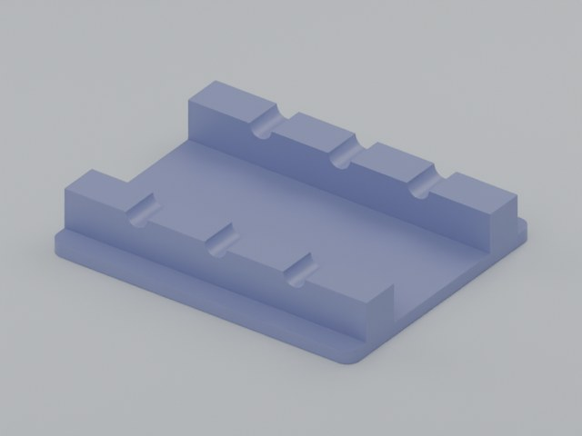

# O02 — Repose 3 thermomètres

*[English](README.md) · Français*

Ranger trois thermomètres ou sondes propres et froids.

- Encombrement STL : **96 × 80 × 15.9 mm**.
- Matière candidate : **PETG**.
- Interface : Trois gorges ouvertes de 7 mm.
- Fichiers : [O02.stl](O02.stl), [O02.step](O02.step), [O02.FCStd](O02.FCStd).

Modèle original nktrois · [CC BY 4.0](../../../LICENSE). Contrôles numériques seulement ; aucune impression, étanchéité, tenue chimique, thermique ou au vide qualifiée.

[Plan d'impression](../../../IMPRESSION.md) · [Catalogue](../../../CATALOGUE.md)

## Sources et réglages

[Générateur FreeCAD](../../../scripts/build_freecad.py) · [Paramètres de référence](source.json). Modifier la ligne de cette pièce dans [catalogue-base.json](../../../catalogue-base.json), puis régénérer. Le fichier `source.json` est un relevé des paramètres ; le générateur utilise les sources indiquées. Les FCStd contiennent un solide et ses métadonnées, sans historique de fonctions esquissées.
