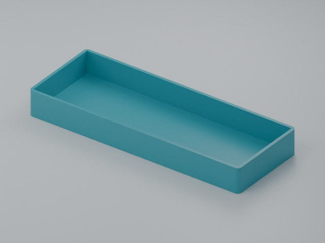

# O04 — Bac de rangement long

*[English](README.md) · Français*

Ranger spatules et petites pièces secs, sans chauffage ni produits dangereux.

- Encombrement STL : **225 × 85 × 26 mm**.
- Matière candidate : **PETG**.
- Interface :
- Fichiers : [O04.stl](O04.stl), [O04.step](O04.step), [O04.FCStd](O04.FCStd).

Modèle original nktrois · [CC BY 4.0](../../../LICENSE). Contrôles numériques seulement ; aucune impression, étanchéité, tenue chimique, thermique ou au vide qualifiée.

[Plan d'impression](../../../IMPRESSION.md) · [Catalogue](../../../CATALOGUE.md)

## Sources et réglages

[Générateur FreeCAD](../../../scripts/build_freecad.py) · [Paramètres de référence](source.json). Modifier la ligne de cette pièce dans [catalogue-base.json](../../../catalogue-base.json), puis régénérer. Le fichier `source.json` est un relevé des paramètres ; le générateur utilise les sources indiquées. Les FCStd contiennent un solide et ses métadonnées, sans historique de fonctions esquissées.
