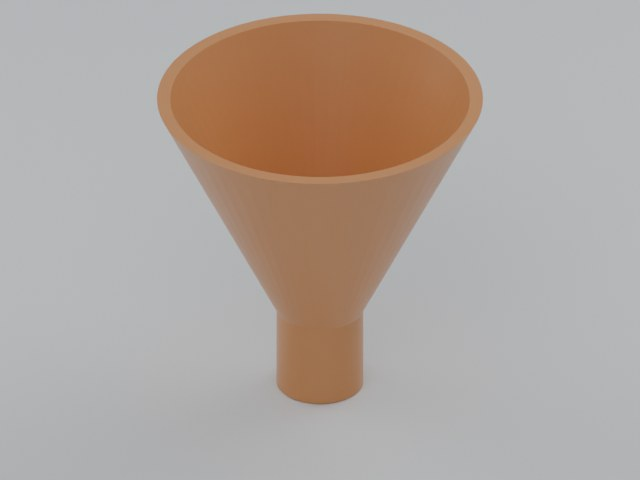

# E01 — Entonnoir de démonstration Ø60

*[English](README.md) · Français*

Transvaser de l'eau ou un liquide bénin à froid, après vérification de compatibilité et d'étanchéité ; pour les réactifs, utiliser un entonnoir de laboratoire adapté.

- Encombrement STL : **59.987 × 59.993 × 60.9 mm**.
- Matière candidate : **PP compatible avec le liquide, à qualifier**.
- Interface : Tige Ø extérieur 16 mm, passage 11 mm ; imprimer debout avec une bordure d'adhérence.
- Fichiers : [E01.stl](E01.stl), [E01.step](E01.step), [E01.FCStd](E01.FCStd).

Modèle original nktrois · [CC BY 4.0](../../../LICENSE). Contrôles numériques seulement ; aucune impression, étanchéité, tenue chimique, thermique ou au vide qualifiée.

[Plan d'impression](../../../IMPRESSION.md) · [Catalogue](../../../CATALOGUE.md)

## Sources et réglages

[Générateur FreeCAD](../../../scripts/build_freecad.py) · [Paramètres de référence](source.json). Modifier la ligne de cette pièce dans [catalogue-base.json](../../../catalogue-base.json), puis régénérer. Le fichier `source.json` est un relevé des paramètres ; le générateur utilise les sources indiquées. Les FCStd contiennent un solide et ses métadonnées, sans historique de fonctions esquissées.
