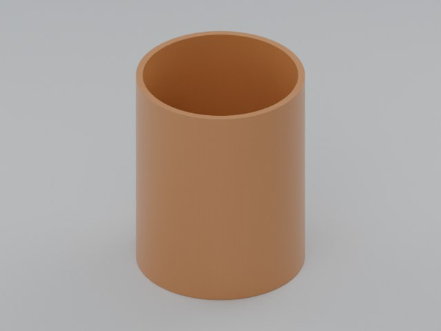

# V02 — Gobelet prototype Ø60 × 75

*[English](README.md) · Français*

Prototype de récipient pour eau ou solution bénigne à température ambiante, après validation de l'étanchéité. Ne remplace pas un bécher de laboratoire.

- Encombrement STL : **59.987 × 59.993 × 75 mm**.
- Matière candidate : **PP compatible avec le liquide, à qualifier**.
- Interface : Sans graduation ni capacité certifiée ; aucune chauffe, pression, stérilisation ou substance dangereuse.
- Fichiers : [V02.stl](V02.stl), [V02.step](V02.step), [V02.FCStd](V02.FCStd).

Modèle original nktrois · [CC BY 4.0](../../../LICENSE). Contrôles numériques seulement ; aucune impression, étanchéité, tenue chimique, thermique ou au vide qualifiée.

[Plan d'impression](../../../IMPRESSION.md) · [Catalogue](../../../CATALOGUE.md)

## Sources et réglages

[Générateur FreeCAD](../../../scripts/build_freecad.py) · [Paramètres de référence](source.json). Modifier la ligne de cette pièce dans [catalogue-base.json](../../../catalogue-base.json), puis régénérer. Le fichier `source.json` est un relevé des paramètres ; le générateur utilise les sources indiquées. Les FCStd contiennent un solide et ses métadonnées, sans historique de fonctions esquissées.
