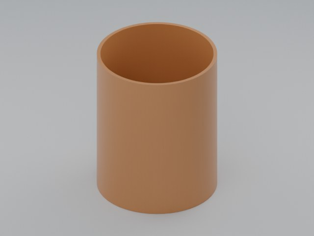

# V03 — Gobelet prototype Ø80 × 100

*[English](README.md) · Français*

Prototype de récipient pour eau ou solution bénigne à température ambiante, après validation de l'étanchéité. Ne remplace pas un bécher de laboratoire.

- Encombrement STL : **79.982 × 79.991 × 100 mm**.
- Matière candidate : **PP compatible avec le liquide, à qualifier**.
- Interface : Sans graduation ni capacité certifiée ; aucune chauffe, pression, stérilisation ou substance dangereuse.
- Fichiers : [V03.stl](V03.stl), [V03.step](V03.step), [V03.FCStd](V03.FCStd).

Modèle original nktrois · [CC BY 4.0](../../../LICENSE). État au dépôt initial (21 novembre 2026) : modèles contrôlés numériquement, avant les premières impressions. Les retours d'impression et les résultats des essais serviront à corriger les cotes, les ajustements et les réglages.

[Plan d'impression](../../../IMPRESSION.md) · [Catalogue](../../../CATALOGUE.md)

## Sources et réglages

[Générateur FreeCAD](../../../scripts/build_freecad.py) · [Paramètres de référence](source.json). Modifier la ligne de cette pièce dans [catalogue-base.json](../../../catalogue-base.json), puis régénérer. Le fichier `source.json` est un relevé des paramètres ; le générateur utilise les sources indiquées. Les FCStd contiennent un solide et ses métadonnées, sans historique de fonctions esquissées.
