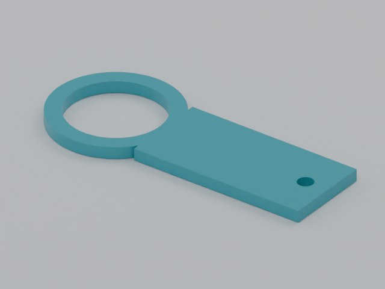

# L01 — Étiquette de col Ø24

*[English](README.md) · Français*

Ajouter une étiquette de rangement autour du col d'un flacon ; garder les mentions réglementaires et l'étiquette du fabricant visibles.

- Encombrement STL : **74 × 31.998 × 3 mm**.
- Matière candidate : **PETG**.
- Interface : Anneau fermé Ø intérieur 24 mm ; passer le col avant de refermer le bouchon, sans interférer avec sa fermeture.
- Fichiers : [L01.stl](L01.stl), [L01.step](L01.step), [L01.FCStd](L01.FCStd).

Modèle original nktrois · [CC BY 4.0](../../../LICENSE). État au dépôt initial (21 novembre 2026) : modèles contrôlés numériquement, avant les premières impressions. Les retours d'impression et les résultats des essais serviront à corriger les cotes, les ajustements et les réglages.

[Plan d'impression](../../../IMPRESSION.md) · [Catalogue](../../../CATALOGUE.md)

## Sources et réglages

[Générateur FreeCAD](../../../scripts/build_freecad.py) · [Paramètres de référence](source.json). Modifier la ligne de cette pièce dans [catalogue-base.json](../../../catalogue-base.json), puis régénérer. Le fichier `source.json` est un relevé des paramètres ; le générateur utilise les sources indiquées. Les FCStd contiennent un solide et ses métadonnées, sans historique de fonctions esquissées.
