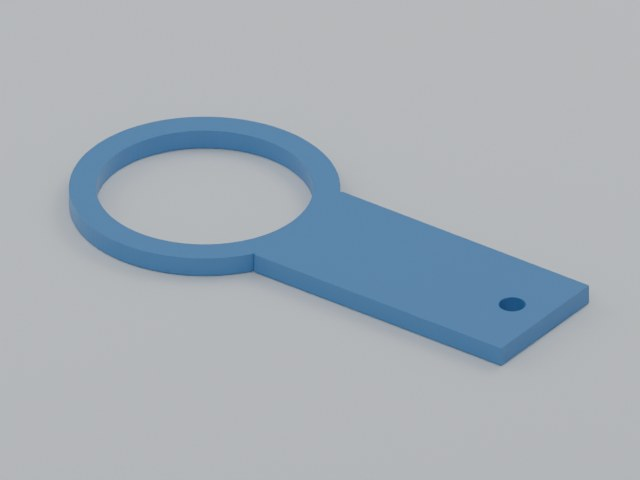

# L02 — Ø32 bottle-neck label

*English · [Français](README.fr.md)*

## Files

- [L02.stl](L02.stl): printable mesh in millimetres.
- [L02.step](L02.step): CAD exchange solid.
- [L02.FCStd](L02.FCStd): native FreeCAD solid and metadata.
- [source.json](source.json): dimensions and source references.

Envelope: **81.991 × 39.999 × 3 mm**. Detailed interface notes are available in the [French notice](README.fr.md).

## Printing

Material candidate: **PETG**, selected for the actual use. See the [printing guide](../../../IMPRESSION.md) for orientation and fit checks. No slicer profile or G-code is included.

## Settings

[FreeCAD generator](../../../scripts/build_freecad.py). Edit this part's entry in [catalogue-base.json](../../../catalogue-base.json) and regenerate. The `source.json` file is a parameter reference; edit the listed generator inputs. FCStd files contain solids and metadata, without a sketch-based feature history.

## Status

Original digital prototype by **nktrois**, under [CC BY 4.0](../../../LICENSE). Initial release (21 November 2026): models checked digitally, before the first prints. Print feedback and test results will guide updates to dimensions, fits and printing settings. See the material and printing notes for the intended use.

[Collection](../../../README.md) · [Illustrated catalogue](../../../CATALOGUE.md)
