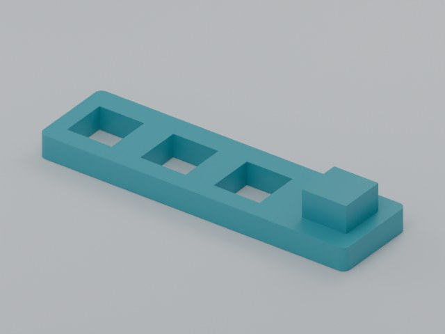

# G02 — Coupon emboîtements des potences

*[English](README.md) · Français*

Tester les trois jeux d'emboîtement avant d'imprimer les grandes potences.

- Encombrement STL : **138 × 38 × 21.9 mm**.
- Matière candidate : **PETG**.
- Interface : Trois logements carrés et un pion solidaire du coupon ; tester avec une colonne séparée ou mesurer au pied à coulisse.
- Fichiers : [G02.stl](G02.stl), [G02.step](G02.step), [G02.FCStd](G02.FCStd).

Modèle original nktrois · [CC BY 4.0](../../../LICENSE). Contrôles numériques seulement ; aucune impression, étanchéité, tenue chimique, thermique ou au vide qualifiée.

[Plan d'impression](../../../IMPRESSION.md) · [Catalogue](../../../CATALOGUE.md)

## Sources et réglages

[Générateur FreeCAD](../../../scripts/build_freecad.py) · [Paramètres de référence](source.json). Modifier la ligne de cette pièce dans [catalogue-base.json](../../../catalogue-base.json), puis régénérer. Le fichier `source.json` est un relevé des paramètres ; le générateur utilise les sources indiquées. Les FCStd contiennent un solide et ses métadonnées, sans historique de fonctions esquissées.
