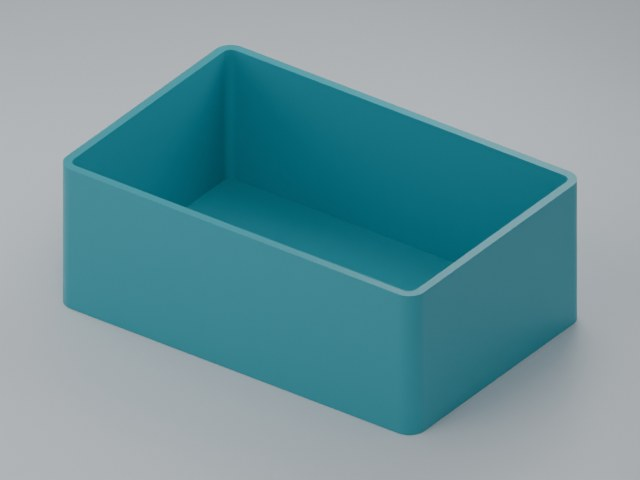

# WB01 — Bain ouvert pour immersion

*[English](README.md) · Français*

Contenir un bain compatible ; ouverture supérieure permettant l'observation et la reprise des échantillons.

- Encombrement STL : **190 × 125 × 70 mm**.
- Matière candidate : **PP non chargé, référence et conditions à qualifier**.
- Interface : Bain + panier WB02 ; pas une rétention de sécurité.
- Fichiers : [WB01.stl](WB01.stl), [WB01.step](WB01.step), [WB01.FCStd](WB01.FCStd).

Modèle original nktrois · [CC BY 4.0](../../../LICENSE). Contrôles numériques seulement ; aucune impression, étanchéité, tenue chimique, thermique ou au vide qualifiée.

[Plan d'impression](../../../IMPRESSION.md) · [Catalogue](../../../CATALOGUE.md)

## Sources et réglages

[Générateur FreeCAD](../../scripts/build_freecad.py) · [Paramètres de référence](source.json). Modifier les dimensions dans le générateur (`P` pour la filtration, `SPECS` pour les autres séries), puis régénérer. Le fichier `source.json` est un relevé des paramètres ; le générateur utilise les sources indiquées. Les FCStd contiennent un solide et ses métadonnées, sans historique de fonctions esquissées.
