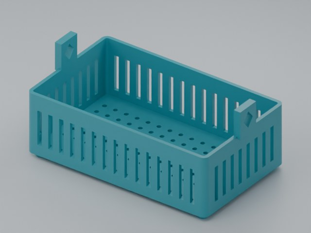

# WB02 — Panier d'immersion perforé

*[English](README.md) · Français*

Introduire et retirer des échantillons assez grands pour rester dans le panier ; circulation du bain par le fond et les côtés.

- Encombrement STL : **170 × 100 × 78 mm**.
- Matière candidate : **PP non chargé, référence et conditions à qualifier**.
- Interface : Pieds de 4 mm ; oreilles ajourées ; ajustement prévu dans WB01. La flottabilité et la charge doivent être testées.
- Fichiers : [WB02.stl](WB02.stl), [WB02.step](WB02.step), [WB02.FCStd](WB02.FCStd).

Modèle original nktrois · [CC BY 4.0](../../../LICENSE). Contrôles numériques seulement ; aucune impression, étanchéité, tenue chimique, thermique ou au vide qualifiée.

[Plan d'impression](../../../IMPRESSION.md) · [Catalogue](../../../CATALOGUE.md)

## Sources et réglages

[Générateur FreeCAD](../../scripts/build_freecad.py) · [Paramètres de référence](source.json). Modifier les dimensions dans le générateur (`P` pour la filtration, `SPECS` pour les autres séries), puis régénérer. Le fichier `source.json` est un relevé des paramètres ; le générateur utilise les sources indiquées. Les FCStd contiennent un solide et ses métadonnées, sans historique de fonctions esquissées.
