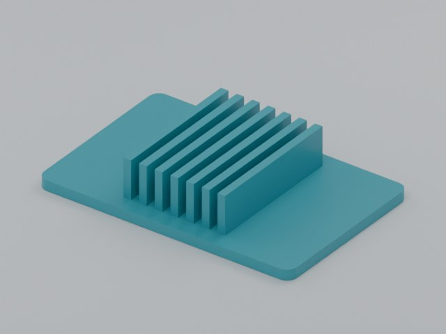

# WB03 — Porte-éprouvettes immergeable

*[English](README.md) · Français*

Maintenir six plaquettes ou éprouvettes dans un bain compatible, sans besoin de transparence de l'outil.

- Encombrement STL : **100 × 65 × 18.88 mm**.
- Matière candidate : **PP non chargé, référence et conditions à qualifier**.
- Interface : Six fentes de 3,2 mm ; dimensions des éprouvettes à mesurer ; aucune conformité à une norme de corrosion revendiquée.
- Fichiers : [WB03.stl](WB03.stl), [WB03.step](WB03.step), [WB03.FCStd](WB03.FCStd).

Modèle original nktrois · [CC BY 4.0](../../../LICENSE). État au dépôt initial (21 novembre 2026) : modèles contrôlés numériquement, avant les premières impressions. Les retours d'impression et les résultats des essais serviront à corriger les cotes, les ajustements et les réglages.

[Plan d'impression](../../../IMPRESSION.md) · [Catalogue](../../../CATALOGUE.md)

## Sources et réglages

[Générateur FreeCAD](../../scripts/build_freecad.py) · [Paramètres de référence](source.json). Modifier les dimensions dans le générateur (`P` pour la filtration, `SPECS` pour les autres séries), puis régénérer. Le fichier `source.json` est un relevé des paramètres ; le générateur utilise les sources indiquées. Les FCStd contiennent un solide et ses métadonnées, sans historique de fonctions esquissées.
