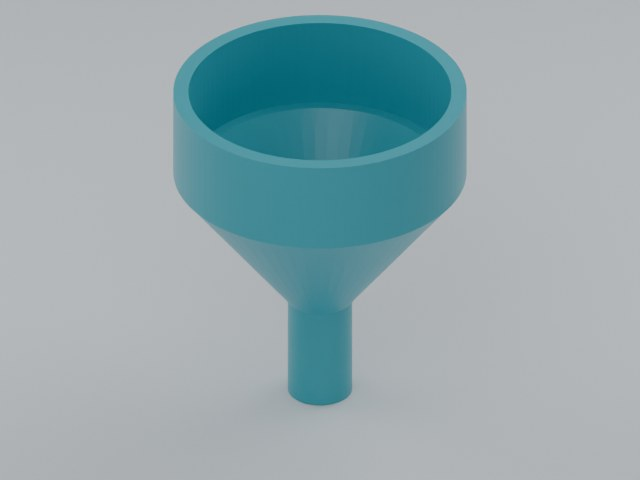

# WF01 — Porte-filtre gravitaire démontable

*[English](README.md) · Français*

Soutenir un médium filtrant commercial avec la grille WF02 et collecter un écoulement gravitaire.

- Encombrement STL : **69.185 × 69.192 × 82 mm**.
- Matière candidate : **PP non chargé, référence et conditions à qualifier**.
- Interface : Portée de grille à z=60 mm ; passage de sortie Ø8 mm. Papier, absence de contournement et filtration à valider. Pas d'aspiration ni de pression.
- Fichiers : [WF01.stl](WF01.stl), [WF01.step](WF01.step), [WF01.FCStd](WF01.FCStd).

Modèle original nktrois · [CC BY 4.0](../../../LICENSE). Contrôles numériques seulement ; aucune impression, étanchéité, tenue chimique, thermique ou au vide qualifiée.

[Plan d'impression](../../../IMPRESSION.md) · [Catalogue](../../../CATALOGUE.md)

## Sources et réglages

[Générateur FreeCAD](../../scripts/build_freecad.py) · [Paramètres de référence](source.json). Modifier les dimensions dans le générateur (`P` pour la filtration, `SPECS` pour les autres séries), puis régénérer. Le fichier `source.json` est un relevé des paramètres ; le générateur utilise les sources indiquées. Les FCStd contiennent un solide et ses métadonnées, sans historique de fonctions esquissées.
