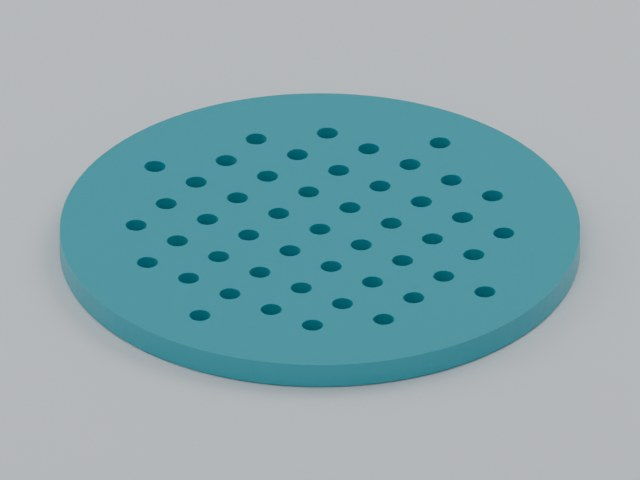

# WF02 — Grille amovible de filtration

*[English](README.md) · Français*

Supporter un papier ou médium filtrant commercial dans WF01 ; la grille imprimée n'est pas elle-même le filtre fin.

- Encombrement STL : **61.186 × 61.193 × 3 mm**.
- Matière candidate : **PP non chargé, référence et conditions à qualifier**.
- Interface : Ø61,2 mm dans un logement Ø62 mm ; trous Ø2,5 mm. La zone perforée doit être entièrement couverte par le médium.
- Fichiers : [WF02.stl](WF02.stl), [WF02.step](WF02.step), [WF02.FCStd](WF02.FCStd).

Modèle original nktrois · [CC BY 4.0](../../../LICENSE). Contrôles numériques seulement ; aucune impression, étanchéité, tenue chimique, thermique ou au vide qualifiée.

[Plan d'impression](../../../IMPRESSION.md) · [Catalogue](../../../CATALOGUE.md)

## Sources et réglages

[Générateur FreeCAD](../../scripts/build_freecad.py) · [Paramètres de référence](source.json). Modifier les dimensions dans le générateur (`P` pour la filtration, `SPECS` pour les autres séries), puis régénérer. Le fichier `source.json` est un relevé des paramètres ; le générateur utilise les sources indiquées. Les FCStd contiennent un solide et ses métadonnées, sans historique de fonctions esquissées.
