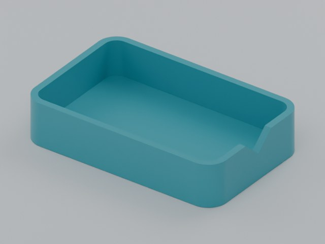

# WP01 — Nacelle de pesée à bec

*[English](README.md) · Français*

Peser et transférer un produit compatible avec une balance commerciale, après tare de la nacelle.

- Encombrement STL : **85 × 55 × 18 mm**.
- Matière candidate : **PP non chargé, référence et conditions à qualifier**.
- Interface : Lecture de masse sur la balance ; pas de dosage volumétrique ni de propreté analytique certifiés.
- Fichiers : [WP01.stl](WP01.stl), [WP01.step](WP01.step), [WP01.FCStd](WP01.FCStd).

Modèle original nktrois · [CC BY 4.0](../../../LICENSE). Contrôles numériques seulement ; aucune impression, étanchéité, tenue chimique, thermique ou au vide qualifiée.

[Plan d'impression](../../../IMPRESSION.md) · [Catalogue](../../../CATALOGUE.md)

## Sources et réglages

[Générateur FreeCAD](../../scripts/build_freecad.py) · [Paramètres de référence](source.json). Modifier les dimensions dans le générateur (`P` pour la filtration, `SPECS` pour les autres séries), puis régénérer. Le fichier `source.json` est un relevé des paramètres ; le générateur utilise les sources indiquées. Les FCStd contiennent un solide et ses métadonnées, sans historique de fonctions esquissées.
