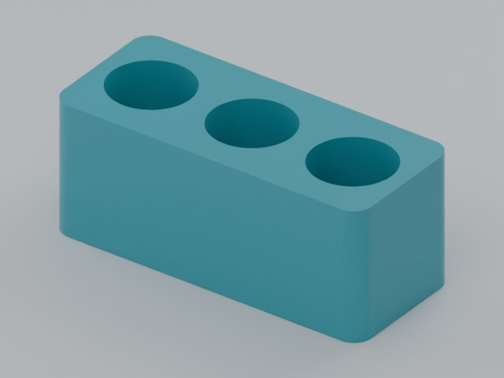

# WP03 — Bloc de rinçage à trois postes

*[English](README.md) · Français*

Réaliser des rinçages successifs d'une sonde ou d'un petit outil avec trois liquides compatibles dans des puits indépendants.

- Encombrement STL : **104 × 44 × 42 mm**.
- Matière candidate : **PP non chargé, référence et conditions à qualifier**.
- Interface : Trois puits Ø26 mm, profondeur 36 mm ; repérer les postes et vérifier les contaminations croisées.
- Fichiers : [WP03.stl](WP03.stl), [WP03.step](WP03.step), [WP03.FCStd](WP03.FCStd).

Modèle original nktrois · [CC BY 4.0](../../../LICENSE). État au dépôt initial (21 novembre 2026) : modèles contrôlés numériquement, avant les premières impressions. Les retours d'impression et les résultats des essais serviront à corriger les cotes, les ajustements et les réglages.

[Plan d'impression](../../../IMPRESSION.md) · [Catalogue](../../../CATALOGUE.md)

## Sources et réglages

[Générateur FreeCAD](../../scripts/build_freecad.py) · [Paramètres de référence](source.json). Modifier les dimensions dans le générateur (`P` pour la filtration, `SPECS` pour les autres séries), puis régénérer. Le fichier `source.json` est un relevé des paramètres ; le générateur utilise les sources indiquées. Les FCStd contiennent un solide et ses métadonnées, sans historique de fonctions esquissées.
