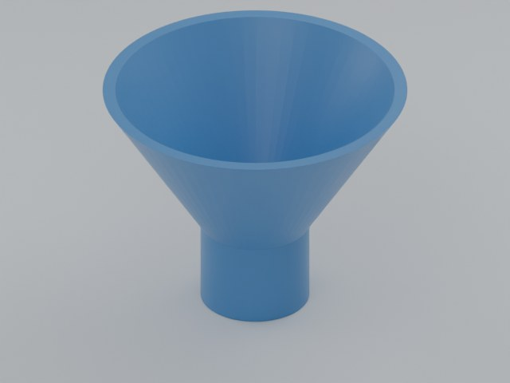

# QP080 — Entonnoir PP pour poudres Ø80

*[English](README.md) · Français*

Manipulation en récipient ouvert de solutions ou produits compatibles avec le grade et le procédé effectivement qualifiés.

- Encombrement STL : **87.2 × 87.173 × 68 mm**.
- Matière candidate : **PP non chargé, grade et usage à qualifier**.
- Interface : Consulter les dimensions et paramètres du catalogue.
- Fichiers : [QP080.stl](QP080.stl), [QP080.step](QP080.step), [QP080.FCStd](QP080.FCStd).

Modèle original nktrois · [CC BY 4.0](../../../LICENSE). Contrôles numériques seulement ; aucune impression, étanchéité, tenue chimique, thermique ou au vide qualifiée.

[Plan d'impression](../../../IMPRESSION.md) · [Catalogue](../../../CATALOGUE.md)

## Sources et réglages

[Générateur FreeCAD](../../scripts/build_recipients_freecad.py) · [Paramètres de référence](source.json). Modifier les dimensions dans le générateur (`P` pour la filtration, `SPECS` pour les autres séries), puis régénérer. Le fichier `source.json` est un relevé des paramètres ; le générateur utilise les sources indiquées. Les FCStd contiennent un solide et ses métadonnées, sans historique de fonctions esquissées.
